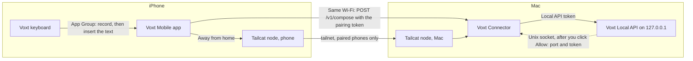

# Voxt Mobile

Dictate on your iPhone with the models Voxt runs on your Mac. Tap the mic on the Voxt keyboard in any app and speak; Voxt on the Mac transcribes with your speech model, cleans up with your text model, prompt and dictionary, and the text appears in the field you were typing in. With local models in Voxt, the recording and the text stay on your phone and your Mac.

Four ways to write: **dictate**, **translate** (hold the mic and slide up to a language), **edit** the selected text by saying what to change, and **write** from a spoken request. The keyboard also types English, French, German, Spanish and Korean, plus Japanese flick, pinyin and Zhuyin when the build includes `ios/InputMethods/`.

Three apps work together:

- **Voxt** on the Mac, with its [Local API](../docs/LocalAPI.md) turned on.
- **Voxt Connector**, a menu bar app on the same Mac. It gets Voxt's port and token after one **Allow** and lets only the phones you added reach the Local API, on the same Wi-Fi or from anywhere through a [Tailcat](https://github.com/tailscale/tailcat) tailnet node it runs itself; the phone needs no VPN app.
- **Voxt** on the iPhone: the app and its keyboard. An iOS keyboard cannot use the microphone, so the keyboard asks the app to record and the app sends the recording to the Mac.

## Set it up

You need an Apple silicon Mac with Xcode 26 or later (tested with 27.0), Go and XcodeGen (`brew install go xcodegen`), and an iPhone on iOS 17 or later with an Apple ID in Xcode; a free one works. `go.mod` asks for Go 1.27.1: with an older Go the scripts download that version into `Voxt/Mobile/build/` on first use, which needs network; offline they stop with what to install.

An AI coding agent can follow this section top to bottom from the repository root; the steps that need a person say so.

**On the Mac**

1. Build and open Voxt ([CONTRIBUTING](../CONTRIBUTING.md)). Choose a speech model and a text model, then turn on **Settings → General → Local API → Allow other apps to dictate through Voxt**.
2. Build Voxt Connector:

   ```sh
   Voxt/Mobile/tools/build-connector.sh
   ```

   Move the app at the printed `build:` path to `/Applications` and open it. If Voxt and the Connector are signed by the same team, Voxt asks once to let the Connector in (person: click **Always Allow**). Otherwise copy the port and **Access token** from Voxt's Local API card into Connector Settings. Without an Apple Development certificate, build with `VOXT_CONNECTOR_SIGNING_IDENTITY=-` (ad hoc) and enter them the same way.

**On the iPhone**

1. Build the Tailcat library the app links:

   ```sh
   Voxt/Mobile/tools/build-tailcat-native.sh
   ```

2. Copy `Voxt/Mobile/ios/Config/Signing.local.xcconfig.example` to `Signing.local.xcconfig` in the same folder and set your team ID and an ID prefix nobody else uses. The file is gitignored.
3. Open `Voxt/Mobile/ios/VoxtMobile.xcodeproj` and run the `VoxtMobile` scheme on the iPhone.
4. Person: in Voxt Connector click **Add iPhone**, scan the QR with the iPhone Camera and open the link in Voxt.
5. Person: in iPhone Settings, **General → Keyboard → Keyboards → Add New Keyboard → Voxt**, then turn on **Allow Full Access**. Switch to the Voxt keyboard and tap the mic.

## Build and test

The `voxt-mobile` job in `.github/workflows/voxt-mac-ci.yaml` runs these on the Mac runner; nothing is signed.

```sh
cd Voxt/Mobile
source tools/tailcat-go-env.sh
for m in tailcat/native tailcat/host; do tailcat_prepare_go "$m" && (cd "$m" && "$GO_BIN" test ./...); done
tools/build-tailcat-native.sh
for p in ios/VoxtMobileKit ios/VoxtTailcat ios/TypingInput ios/KoreanInput ios/SpanishInput; do swift test --package-path "$p"; done
tools/test-package.sh                                  # VoxtConnectionKit
simulator="iPhone 17 Pro"                              # any iPhone in `xcrun simctl list devices available`
xcodebuild test -project ios/VoxtMobile.xcodeproj -scheme VoxtMobile \
  -destination "platform=iOS Simulator,name=$simulator" -only-testing:VoxtMobileTests CODE_SIGNING_ALLOWED=NO ARCHS=arm64
for t in tools/test_*.py; do python3 -I "$t"; done
```

One VoxtMobileKit test writes to the login Keychain, which CI runners and a shell with another HOME don't have (macOS would wait on a Keychain dialog), so it is skipped unless you ask for it: `VOXT_KEYCHAIN_TESTS=1 swift test --package-path ios/VoxtMobileKit`.

The UI tests (`VoxtMobileUITests`) run on a simulator against `tools/design-tour-fixture.py`, a loopback server that answers like the Local API without a model; each test names the environment it reads. After editing `ios/project.yml`, run `xcodegen generate` in `ios/`.

`ios/InputMethods.yml` brings in the Japanese, pinyin and Zhuyin packages (about 42 MB, mostly dictionaries). Remove its `include` line in `ios/project.yml` to build without them; `ios/tools/test-input-methods-optional.sh` checks that build.

## How it fits together



```
Voxt/Mobile/
├── ios/            iPhone app, keyboard extension, VoxtMobileKit (pairing, API client, history),
│                   VoxtTailcat (phone tailnet node), typing layouts; InputMethods/ (optional) = Japanese, pinyin, Zhuyin
├── connector/      Voxt Connector: Mac menu bar app + VoxtConnectionKit
├── tailcat/        Go: native/ (phone node → xcframework), host/ (Mac node, bundled into the Connector)
├── contract/       Local API request/response fixtures, tested on both sides
├── tools/          build scripts, loopback fixture server, end-to-end runner, their tests
├── testdata/       jfk.wav, zh.wav
├── docs/           evidence of the acceptance and end-to-end runs
└── README.md       set-up, build and test, how it fits together
```

| Folder | What it is |
| --- | --- |
| `ios/App`, `ios/Keyboard` | The iPhone app and its keyboard extension |
| `ios/VoxtMobileKit` | Pairing, the Local API client, the keyboard–app channel, history |
| `ios/VoxtTailcat`, `tailcat/native` | The phone's tailnet node: Go, built into `CVoxtTailcat.xcframework` |
| `ios/TypingInput`, `KoreanInput`, `SpanishInput`, `InputMethods/` | Typing layouts and conversion engines |
| `connector/VoxtConnector`, `connector/VoxtConnectionKit` | The Mac menu bar app and its logic |
| `tailcat/host` | The Mac's tailnet node, bundled into the Connector |
| `contract/` | Local API responses both sides test against |
| `tools/` | Build scripts, fixture servers and their tests |

One dictation from the keyboard: the keyboard writes a command to the App Group and posts a Darwin notification; the app records, sends the WAV to `POST /v1/compose` through the Connector with its pairing token, and writes the result back to the App Group; the keyboard inserts it only if the text field still matches the one you dictated into. The keyboard never holds the token.

The Connector reaches Voxt over loopback with the Local API token. Voxt hands that token only to a Connector signed by Voxt's own team with the bundle ID `com.voxt.VoxtConnector`, after you allow it. A pairing QR expires after two minutes, works for one phone and never contains the token. The Connector's tailnet node accepts only the phones you added.

To add a capability (for example speech output), add the route to Voxt's `LocalAPIRouter` with a contract fixture and a router test, list it in `/v1/capabilities` `endpoints`, and show the phone feature only when `endpoints` contains it.

## Licenses

Apache-2.0, as the rest of the repository. Third-party code and data keep their own licenses; see [NOTICE](NOTICE).
