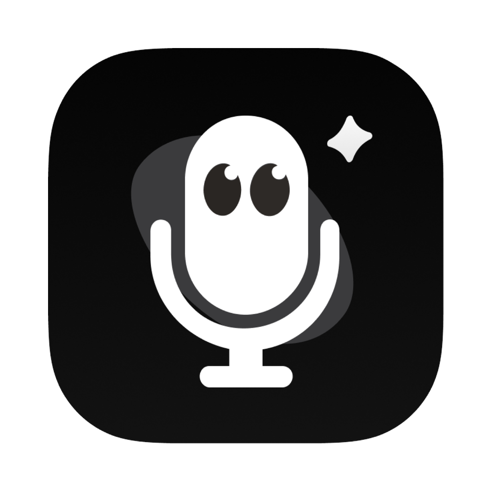

<div align="center"><a name="readme-top"></a>



# Voxt

**Speak in any app on your Mac. Voxt writes it down, translates it, or answers you.**

Open-source voice input for macOS, from the [SGLang-Omni](https://github.com/sgl-project/sglang-omni) team.

**English** · [简体中文](README.zh-CN.md)

[![Latest Voxt release][release-shield]][download]
[![macOS 15 or later, Apple silicon][macos-shield]](#requirements)
[![Apache License 2.0][licence-shield]](LICENSE)

[![Download Voxt for Mac][download-shield]][download]

[Install guide][install-guide] · [Changelog](CHANGELOG.md) · [Website](https://voxt.actnow.dev) · [Report a problem][issues] · [Slack][slack]

<a href="https://youtu.be/ktJRE7AB2mU"></a>

▶ **Watch the Voxt 2.0 launch video**: [English](https://youtu.be/ktJRE7AB2mU) · [中文](https://youtu.be/mOwWavTSXu0)

</div>

## Voxt 2.0 is here

Today we are releasing **Voxt 2.0**, and with it a new idea of what open-source voice interaction can be.

Voice input built on speech recognition plus a language model's polish. Any-to-any translation by a language model. A local AI assistant that responds to any text you select, the moment you ask out loud. Voxt 2.0 is the new entry point to interactive intelligence that we, the SGLang-Omni team, are proud of.

- **Rebuilt from Swift to Go, and faster where it hurt most.** After a very long dictation, the wait once you stop is **92% shorter** than in Voxt 1.x. Voxt 2 recognises the finished parts of a long recording while you are still speaking, instead of all of it after you stop: for a dictation of 4 min 46 s on a Mac with an M4 and 24 GB, 32.3 s became 2.6 s ([how it was measured](docs/eval.md#long-recordings-on-the-speech-model-10-17-testevallongasr)).
- **Everything from Voxt 1.x, in one click.** Your dictionary, history, compatible speech models and service setups come over, so your habits stay as they were.
- **Nothing you said is lost.** When recognition fails, the recording is kept and **Retry** in History recognises it again.
- **A conversation in the answer card.** A result can wait in a floating card: keep asking follow-ups by voice, then copy or insert the answer.
- **Your models, your data.** Speech runs on your Mac with Qwen3-ASR or MOSS-Transcribe-Diarize, served by the SGLang-Omni MLX runtime, or goes to a cloud speech API you set up. The language model is anything with an OpenAI-compatible API: SGLang MLX or Ollama on your Mac, or a service such as DeepSeek V4.1 and Kimi K3.1, the two our team uses most. Where your data goes is yours to decide.
- **Optional DFlash acceleration for Qwen3-ASR.** **Faster transcription** adds a small draft model, and the speech model transcribes faster by speculative decoding.
- **And more**: sign in with ChatGPT instead of pasting an API key, a fallback model for Translate, your own prompts, and History export to Markdown or JSONL.

Already on Voxt 1.x? See [Coming from Voxt 1.x](#coming-from-voxt-1x). Every change, version by version: [CHANGELOG.md](CHANGELOG.md).

## What Voxt does

Tap a shortcut in any app, speak, and tap it again. Esc cancels.

### Transcribe: voice input

Tap **right ⌥ Option**. What you say is typed where your cursor is. The text shows live while you speak, and a language model can polish it: fillers and false starts out, punctuation in.

### Translate: any language to any language

**Right ⌥** with **⇧ Shift**. The selected text, or what you say, comes back in another language: 22 target languages, by the language model you choose.

### Rewrite: your AI assistant

**⌃ Control** with **right ⌥**. Select any text and say what you want: "shorter", "more formal", "explain this". Or select nothing and ask for new text. The answer waits in a card, where you can follow up by voice, then copy or insert it.

### Also built in

- **App enhancement**: groups of apps and websites with their own prompt and a key pressed after inserting, such as a casual tone in chats and Return to send.
- **Dictionary**: names and jargon that the speech model expects and the language model writes as you spell them. Voxt suggests new terms from your history and from the corrections you make.
- **Notes**: tap right ⌘, speak, and Voxt saves what you said as a note instead of typing it.
- **History**: every result, with search, **Retry** from the recording, and export.

Every shortcut can be changed on its feature's page, and Settings → Shortcuts has presets: right ⌥, fn, ⌘ combinations, or the middle mouse button. ⌃⌥V pastes the last result again.

## Install

### New to Voxt

1. **Download** the newest `Voxt-X.Y.Z-arm64.dmg` from [the Voxt releases][download], open it and drag **Voxt** to **Applications**. Or install it with Homebrew:

   ```sh
   brew install --cask hehehai/tap/voxt
   ```

2. **Open Voxt and follow the setup guide**: allow the microphone and Accessibility, download the recommended speech model (Qwen3-ASR 1.7B (8bit), 2.5 GB), and set up a language model for clean-up, Translate and Rewrite.
3. **Tap the right Option key** in any app, speak, and tap it again.

Step by step: [Install Voxt][install-guide].

### Coming from Voxt 1.x

Take whichever way is easiest:

- **From inside Voxt 1.x**: choose **Check for Updates…**. On a Mac with Apple silicon it offers Voxt 2 together with the upgrade guide.
- **Install over it**: quit Voxt 1.x, download the newest disk image and drag Voxt to Applications. Choose **Replace** when Finder asks.
- **Homebrew**: the cask above installs Voxt 2.

Then, in Voxt 2:

1. In the setup guide, click **Import from Voxt 1.x**. Your dictionary, history, the speech models you already downloaded, and your language model and speech service setups come over. Voxt 1.x's data is only read, never changed.
2. Allow the microphone and Accessibility again: macOS sees Voxt 2 as a new app.
3. Paste your API keys again and check your shortcuts. These two are not imported.

What the import brings, with screenshots: [From Voxt 1.x to Voxt 2](docs/voxt-migration.md).

### Requirements

- A Mac with **Apple silicon** and **macOS 15** or later. Voxt 2 does not run on an Intel Mac; there, keep using Voxt 1.x.
- About 280 MB for the app, and 2.5 GB for the recommended speech model.
- Voxt 2 does not update itself. Install a newer version the same way: from its disk image, or with `brew upgrade --cask voxt`.

## Your models, your data

### Speech models

Speech is recognised **on your Mac** by the [SGLang-Omni MLX runtime](../sglang_omni_mlx/native): native C++ on MLX, no Python. Voxt downloads a model only when you ask for it, from Hugging Face or from a mirror when Hugging Face cannot be reached, and checks every file against a pinned SHA-256. A model loads when you first dictate and unloads after 10 idle minutes.

| Model | Good at | Download |
|---|---|---|
| **Qwen3-ASR 1.7B (8bit)**, recommended | The most accurate: accents, dialects, names, several languages in one sentence. Live text. | 2.5 GB |
| **Qwen3-ASR 0.6B (4bit)** | Quicker and lighter, for clear speech in a quiet place. Live text. | 713 MB |

- **More local models**: MOSS-Transcribe-Diarize (Chinese and English, live text), Nemotron 3.5 ASR 0.6B (28 languages, live text), Qwen3-ASR 1.7B (6bit), Whisper Large v3 Turbo, Large v3 and Small (about 100 languages), Parakeet TDT 0.6B v3 (25 European languages), SenseVoice Small (Chinese, Cantonese, English, Japanese, Korean) and Cohere Transcribe 03-2026 (14 languages). macOS's own System dictation is there too, with nothing to download.
- **Qwen3-ASR** knows 30 languages and 22 Chinese dialects, and uses your dictionary; the other models you download do not.
- **Faster transcription** (DFlash): on the Qwen3-ASR 1.7B (8bit) and 0.6B (4bit) cards, download a draft model (726 MB and 262 MB). It proposes several words at a time for the speech model to check. Remove it and the model works as before.
- **Cloud speech APIs**, if you prefer one: OpenAI Transcribe, Doubao (Volcengine), Zhipu GLM-ASR, Aliyun Bailian, StepFun, Xiaomi MiMo and Google Gemini.

### Language models

Clean-up, Translate and Rewrite use the language model you set up on the Language models page, over its OpenAI-compatible API:

- **On your Mac**, so the text stays here: Ollama, LM Studio, oMLX, SGLang MLX, or any other compatible server.
- **A service**: OpenAI, Anthropic, Google Gemini, DeepSeek, Qwen (Alibaba Cloud), Kimi, GLM, Doubao (Volcengine), MiniMax, StepFun, Xiaomi MiMo, xAI and OpenRouter.
- **ChatGPT**: sign in with your own ChatGPT plan in the browser, with no API key.

Without a language model, Transcribe types the text as recognised; Translate and Rewrite need one. Each feature can use its own model and its own prompt (**Your rules**), and Translate can fall back on a second model when the first one fails.

## Privacy

- **Speech stays on your Mac**, unless you set up a cloud speech API for a feature: that feature's recordings then go to that service, and nowhere else.
- **Text goes only to the language model you set up.** With a server on your Mac, it stays here. Audio is never sent to a language model.
- **API keys stay in the macOS Keychain**, never in Voxt's settings or logs.
- **No account and no analytics.** Voxt has no server that receives your audio or your text. Otherwise it goes online only to download the models you choose and to read Voxt's announcements, a request that sends nothing about you.
- **Your data is in two folders**: the history, its optional recordings, the dictionary and the settings in `~/Library/Application Support/VoxtNew/`, and the models in `~/Library/Application Support/SGLang Omni/models`.

## Help and community

- **Installing and upgrading**: [Install Voxt][install-guide] and [From Voxt 1.x to Voxt 2](docs/voxt-migration.md).
- **Something is wrong**: Settings → About → **Report a problem** opens a GitHub issue with the diagnostics filled in. Or [open an issue][issues] with "[Voxt]" in its title.
- **Questions and ideas**: join the SGLang [Slack][slack].
- **For your own scripts and agents**: [read your dictation history](docs/history-access.md) from other programs on your Mac. It is off by default.

## For developers

Voxt is a Go app on [MyGo](https://github.com/egoist/mygo), with a small Swift helper and the SGLang-Omni native runtime inside. Everything is in this folder:

- [Build from source, sign and test](docs/development.md)
- [How to send a change](CONTRIBUTING.md), and [the architecture](docs/architecture.md)

## Acknowledgements

Voxt 2 takes the place of the Swift [Voxt](https://github.com/hehehai/voxt) 1.x. It started from [Auralink](https://github.com/hehehai/Auralink) by the same author, with the interface of [AudioSmith](https://github.com/hehehai/AudioSmith). Third-party code, runtimes and their licences are listed in [NOTICE](NOTICE); the models are downloaded under their own licences.

## Licence

Apache License 2.0 ([LICENSE](LICENSE)), as the rest of this repository. Copyright the SGLang-Omni Team.

[![Back to top][back-to-top]](#readme-top)

[download]: https://github.com/sgl-project/sglang-omni/releases?q=voxt-v&expanded=true
[install-guide]: https://sgl-project.github.io/sglang-omni/get_started/voxt.html
[issues]: https://github.com/sgl-project/sglang-omni/issues/new/choose
[slack]: https://slack.sglang.io
[release-shield]: https://img.shields.io/github/v/release/sgl-project/sglang-omni?filter=Voxt%20v%2A&display_name=release&label=latest&style=flat-square&labelColor=000000&color=3fb950&logo=github&logoColor=white
[macos-shield]: https://img.shields.io/badge/macOS-15%2B%20%C2%B7%20Apple%20silicon-58a6ff?style=flat-square&labelColor=000000&logo=apple&logoColor=white
[licence-shield]: https://img.shields.io/badge/licence-Apache%202.0-58a6ff?style=flat-square&labelColor=000000&logo=apache&logoColor=white
[download-shield]: https://img.shields.io/badge/Download-Voxt%20for%20Mac-000000?style=for-the-badge&logo=apple&logoColor=white
[back-to-top]: https://img.shields.io/badge/-BACK_TO_TOP-151515?style=flat-square
