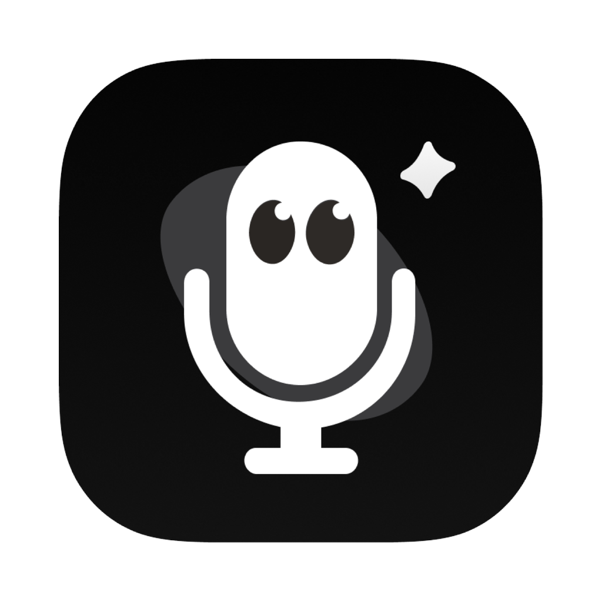

# Voxt

**在 Mac 的任意 App 里开口说话，Voxt 帮你写下来、译出来，或者直接回答你。**

开源的 macOS 语音输入工具，由 [SGLang-Omni](https://github.com/sgl-project/sglang-omni) 团队出品。

[English](README.md) · **简体中文**

[![Voxt 最新版本][release-shield]][download]
[![macOS 15 及以上，Apple 芯片][macos-shield]](#系统要求)
[![Apache License 2.0][licence-shield]](LICENSE)

[![下载 Voxt][download-shield]][download]
[![下载 Voxt Beta][beta-download-shield]][beta-download]

[安装指南][install-guide] · [更新日志](CHANGELOG.md) · [官网](https://voxt.actnow.dev) · [反馈问题][issues] · [Slack][slack]

https://github.com/user-attachments/assets/ab31c202-9415-47a1-b1d3-bc91a7285e8b

▶ **观看 Voxt 2.0 发布视频**：[中文](https://youtu.be/mOwWavTSXu0) · [English](https://youtu.be/ktJRE7AB2mU)

## Voxt 2.0 正式发布

今天，我们正式发布 **Voxt 2.0**，重新定义开源语音的全新交互生态！

无论是语音输入法所依赖的 ASR 识别 + LLM 润色，还是基于 LLM 的 Any to Any translation，以及选中任意文本直接通过语音得到反馈的本地 AI 助手，Voxt 2.0 是让我们 SGLang-Omni 团队自豪的全新交互智能入口。

- **从 Swift 到 Go 的高性能重构。** 语音输入在超长输入后的等待时间相比 1.x 缩短 **92%**：Voxt 2 在你说话的同时就识别已经说完的部分，不再等停下后把整段录音从头识别。一段 4 分 46 秒的录音，在 M4、24 GB 的 Mac 上，停止后的等待从 32.3 秒降到 2.6 秒（[测量方法](docs/eval.md#long-recordings-on-the-speech-model-10-17-testevallongasr)）。
- **Voxt 1.x 一键迁移。** 词典、历史、兼容的语音识别模型和服务配置等用户习惯，都可以一键带过来。
- **说过的话不会丢。** 识别失败时录音会保留，在历史里点“重试”就能重新识别。
- **答案卡片里自由地连续交互。** 结果可以留在浮动的卡片里，接着用语音追问，再复制或插入。
- **充分的模型生态，数据由你定义。** 语音既能使用本地由 SGLang-Omni MLX Runtime 强力支持的 Qwen3-ASR 或 MOSS-Transcribe-Diarize，也能接入云端 ASR API。语言模型方面，任何提供 OpenAI compatible API 的模型都可以作为强力支持：无论是 SGLang MLX、Ollama，还是我们团队常用的 DeepSeek V4.1 和 Kimi K3.1。数据去哪里，由你决定。
- **Qwen3-ASR 可选的 DFlash 转录加速。** “转录加速”加一个小的草稿模型，用推测解码让语音识别模型更快。
- **还有**：ChatGPT 登录（不用填 API Key）、翻译备用模型、自定义提示词，以及 Markdown / JSONL 历史导出。

已经在用 Voxt 1.x？看[从 Voxt 1.x 升级](#从-voxt-1x-升级)。各版本的改动见 [CHANGELOG.md](CHANGELOG.md)。

## Voxt 能做什么

在任意 App 里按一下快捷键，说话，再按一下。按 Esc 取消。

### 转录：语音输入法

单按**右 ⌥ Option**。说的话输入到光标处；说话时实时显示文字，还可以由语言模型整理润色：去掉口头语和说了一半的话，补上标点。

### 翻译：Any to Any

**右 ⌥** 加 **⇧ Shift**。把选中的文字，或者说的话，译成另一种语言：22 种目标语言，由你选的语言模型翻译。

### 改写：你的 AI 助手

**⌃ Control** 加**右 ⌥**。选中任意文本，说一句要求：“短一点”“正式一点”“解释一下”；什么都不选，就按语音要求写新内容。回答留在卡片里，可以接着用语音追问，再复制或插入。

### 还有这些

- **应用增强**：把 App 和网站分组，每组有自己的提示词和插入后的按键，比如聊天时口语一些，插入后按回车发送。
- **词典**：人名和专业术语，语音识别模型提前知道，语言模型照你的写法输出。Voxt 还会从历史和你的改正里建议新词。
- **笔记**：单按右 ⌘ 说话，Voxt 把说的话存成笔记，不输入到 App 里。
- **历史**：每一条结果都在，可以搜索、从录音“重试”、导出。

每个快捷键都可以在对应的功能页里改，“设置 → 快捷键”里还有预设：右 ⌥、fn、⌘ 组合键，或者鼠标中键。⌃⌥V 再次粘贴上一条结果。

## 安装

### 第一次用 Voxt

1. **下载** [`Voxt-2.0.3-arm64.dmg`][download]，打开后把 **Voxt** 拖进“应用程序”。

2. **打开 Voxt，跟着设置引导走**：授权麦克风和辅助功能，下载推荐的语音识别模型（Qwen3-ASR 1.7B (8bit)，2.5 GB），再配置一个语言模型用于整理、翻译和改写。
3. 在任意 App 里**单按右 Option**，说话，再按一下。

分步说明：[Install Voxt][install-guide]。

安装 Beta `2.0.3-beta.20261111.38` 时，先登录 GitHub，下载并解压 ZIP，然后打开 DMG，把 **Voxt** 拖进“应用程序”。如果直链未开始下载，请到 [Voxt Beta #38][beta-run] 的 Artifacts 下载 arm64 安装包。要找更新的 Beta，请打开 [Actions → Voxt Beta][beta-workflow] 中 `main` 分支最新一次成功的运行。

### 从 Voxt 1.x 升级

两种方式任选其一：

- **在 Voxt 1.x 里检查更新**：在 Apple 芯片的 Mac 上，先打开“Beta 更新”（设置 → 关于），再点“检查更新…”，会看到 Voxt 2 和升级指南。没打开“Beta 更新”时，Voxt 1.x 暂时还不会提供 Voxt 2。
- **覆盖安装**：退出 Voxt 1.x，下载最新的 dmg，把 Voxt 拖进“应用程序”，访达询问时选“替换”。

装好后，在 Voxt 2 里：

1. 在设置引导里点**从旧版 Voxt 导入**：词典、历史、已下载的语音识别模型，以及语言模型服务和语音服务的配置都会带过来。Voxt 1.x 的数据只读不改。
2. 重新授权麦克风和辅助功能：macOS 把 Voxt 2 当成一个新的 app。
3. 重新粘贴 API Key，再确认一下快捷键：这两样不会导入。

导入了什么（附截图）：[From Voxt 1.x to Voxt 2](docs/voxt-migration.md)。

### 系统要求

- **Apple 芯片**、**macOS 15** 及以上的 Mac。Voxt 2 不能在 Intel Mac 上运行，那里请继续用 Voxt 1.x。
- app 约 280 MB，推荐的语音识别模型需下载 2.5 GB。
- Voxt 2 有新版本时会提示（“检查更新…”，以及每天一次的自动检查，可以在 设置 → 诊断与关于 里关掉），但不会自己安装。新版本用同样的方式安装：从 dmg 安装。

## 你的模型，你的数据

### 语音识别模型

语音**在你的 Mac 上**识别，由 [SGLang-Omni MLX Runtime](../sglang_omni_mlx/native) 驱动：基于 MLX 的原生 C++，不用 Python。模型在你需要时才从 Hugging Face 下载（连不上时走镜像），每个文件都按固定的 SHA-256 校验；第一次听写时加载，闲置 10 分钟后卸载。

| 模型 | 擅长什么 | 下载大小 |
|---|---|---|
| **Qwen3-ASR 1.7B (8bit)**，推荐 | 最准确：口音、方言、人名、一句话里夹几种语言。实时显示文字。 | 2.5 GB |
| **Qwen3-ASR 0.6B (4bit)** | 更快、更省内存，适合在安静环境里清晰地说话。实时显示文字。 | 713 MB |

- **更多本地模型**：MOSS-Transcribe-Diarize（中文和英语，实时显示文字）、Nemotron 3.5 ASR 0.6B（28 种语言，实时显示文字）、Qwen3-ASR 1.7B (6bit)、Whisper Large v3 Turbo / Large v3 / Small（约 100 种语言）、Parakeet TDT 0.6B v3（25 种欧洲语言）、SenseVoice Small（中文、粤语、英语、日语、韩语）和 Cohere Transcribe 03-2026（14 种语言）。macOS 自带的系统听写也可以用，无需下载。
- **Qwen3-ASR** 支持 30 种语言和 22 种中文方言，并且会用到你的词典；其他可下载的模型不用词典。
- **转录加速**（DFlash）：在 Qwen3-ASR 1.7B (8bit) 和 0.6B (4bit) 的卡片上下载一个草稿模型（726 MB 和 262 MB），它每步先提出几个词，再由语音识别模型校验。删掉它，模型照常工作。
- **云端语音 API**，如果你更想用：OpenAI Transcribe、豆包（火山引擎）、智谱 GLM-ASR、阿里云百炼、阶跃星辰、小米 MiMo 和 Google Gemini。

### 语言模型

整理、翻译和改写使用你在“语言模型”页设置的模型，通过它的 OpenAI 兼容 API 调用：

- **在你的 Mac 上**，文字不离开本机：Ollama、LM Studio、oMLX、SGLang MLX，或者其他兼容的服务。
- **在线服务**：OpenAI、Anthropic、Google Gemini、DeepSeek、通义千问（阿里云百炼）、Kimi、智谱 GLM、豆包（火山方舟）、MiniMax、阶跃星辰、小米 MiMo、xAI 和 OpenRouter。
- **ChatGPT**：在浏览器里用你自己的 ChatGPT 套餐登录，不用 API Key。

没有语言模型时，转录直接输入识别出的原文；翻译和改写需要它。每个功能可以用各自的模型和各自的提示词（“你的规则”），翻译还可以设一个备用模型，在第一个模型失败时接手。

## 隐私

- **语音留在你的 Mac 上**，除非你给某个功能设置了云端语音 API：这个功能的录音只会发给那个服务。
- **文字只发给你设置的语言模型。** 用本机的服务时，文字也留在本机。音频从不发给语言模型。
- **API Key 保存在 macOS 钥匙串里**，不会写进 Voxt 的设置或日志。
- **不需要账号，也不做统计。** Voxt 没有接收你音频或文字的服务器。除此之外，它只在下载你选择的模型和读取 Voxt 的公告时联网，读取公告的请求不带任何关于你的信息。
- **数据在两个文件夹里**：历史、可选保存的录音、词典和设置在 `~/Library/Application Support/VoxtNew/`，模型在 `~/Library/Application Support/SGLang Omni/models`。

## 帮助与社区

- **安装和升级**：[Install Voxt][install-guide] 和 [From Voxt 1.x to Voxt 2](docs/voxt-migration.md)。
- **遇到问题**：“设置 → 诊断与关于 → 反馈问题”会打开一个已填好诊断信息的 GitHub issue；也可以直接[提 issue][issues]，标题带上“[Voxt]”。
- **提问和建议**：加入 SGLang 的 [Slack][slack]。
- **给你自己的脚本和 agent**：让这台 Mac 上的其他程序[读取听写历史](docs/history-access.md)，默认关闭。

## 开发者

Voxt 是基于 [MyGo](https://github.com/egoist/mygo) 的 Go 应用，带一个小的 Swift 辅助进程，内置 SGLang-Omni 的原生运行时。相关内容都在这个目录里：

- [从源码构建、签名和测试](docs/development.zh-CN.md)
- [怎么提交改动](CONTRIBUTING.md#参与贡献)和[架构](docs/architecture.md)

## 致谢

Voxt 2 取代了 Swift 版的 [Voxt](https://github.com/hehehai/voxt) 1.x。它由同一作者的 [Auralink](https://github.com/hehehai/Auralink) 发展而来，界面来自 [AudioSmith](https://github.com/hehehai/AudioSmith)。第三方代码、运行时和它们的许可见 [NOTICE](NOTICE)；模型按各自的许可下载。

## 许可

Apache License 2.0（[LICENSE](LICENSE)），与本仓其余部分一致。版权归 SGLang-Omni 团队所有。

[![回到顶部][back-to-top]](#readme-top)

[download]: https://github.com/sgl-project/sglang-omni/releases/download/voxt-v2.0.3/Voxt-2.0.3-arm64.dmg
[beta-download]: https://github.com/sgl-project/sglang-omni/actions/runs/42954481839/artifacts/13825829109
[beta-run]: https://github.com/sgl-project/sglang-omni/actions/runs/42954481839#artifacts
[beta-workflow]: https://github.com/sgl-project/sglang-omni/actions/workflows/voxt-beta.yaml
[install-guide]: https://sgl-project.github.io/sglang-omni/get_started/voxt.html
[issues]: https://github.com/sgl-project/sglang-omni/issues/new/choose
[slack]: https://slack.sglang.io
[release-shield]: https://img.shields.io/github/v/release/sgl-project/sglang-omni?filter=Voxt%20v%2A&display_name=release&label=latest&style=flat-square&labelColor=000000&color=3fb950&logo=github&logoColor=white
[macos-shield]: https://img.shields.io/badge/macOS-15%2B%20%C2%B7%20Apple%20silicon-58a6ff?style=flat-square&labelColor=000000&logo=apple&logoColor=white
[licence-shield]: https://img.shields.io/badge/licence-Apache%202.0-58a6ff?style=flat-square&labelColor=000000&logo=apache&logoColor=white
[download-shield]: https://img.shields.io/badge/Download-Voxt%20for%20Mac-000000?style=for-the-badge&logo=apple&logoColor=white
[beta-download-shield]: https://img.shields.io/badge/Download-Voxt%20Beta-1f6feb?style=for-the-badge&logo=github&logoColor=white
[back-to-top]: https://img.shields.io/badge/-BACK_TO_TOP-151515?style=flat-square
