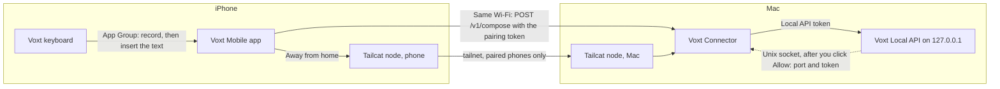

# Voxt Mobile

Dictate on your iPhone with the models Voxt runs on this Mac. The Voxt keyboard records in any app; Voxt turns the recording into text with the speech model, text model, prompt and dictionary you chose here, and the phone types it where you were writing.

Setup, building and tests: [Voxt/Mobile/README.md](../Mobile/README.md).

## What Voxt does for the phone

- **Local API.** Turn on **Settings → General → Local API**. Voxt listens on `127.0.0.1` only; the phone reaches it through Voxt Connector, a menu bar app on the same Mac. Requests and responses: [Local API](LocalAPI.md).
- **Connector link.** When Voxt Connector asks for the port and token, Voxt shows **Always Allow**, **Allow Once** and **Don't Allow**. Voxt answers only a Connector signed by its own team; with the sandboxed release build it must also be installed in `/Applications`. Any other Connector gets the port and token typed in by hand.
- **Results.** A phone dictation runs your text model and dictionary like one on the Mac and is saved to History with the source **Local API**; an edit that could not be applied is not saved.

## How it fits together

The folders and how to build and test them: [Voxt/Mobile/README.md](../Mobile/README.md#how-it-fits-together).
