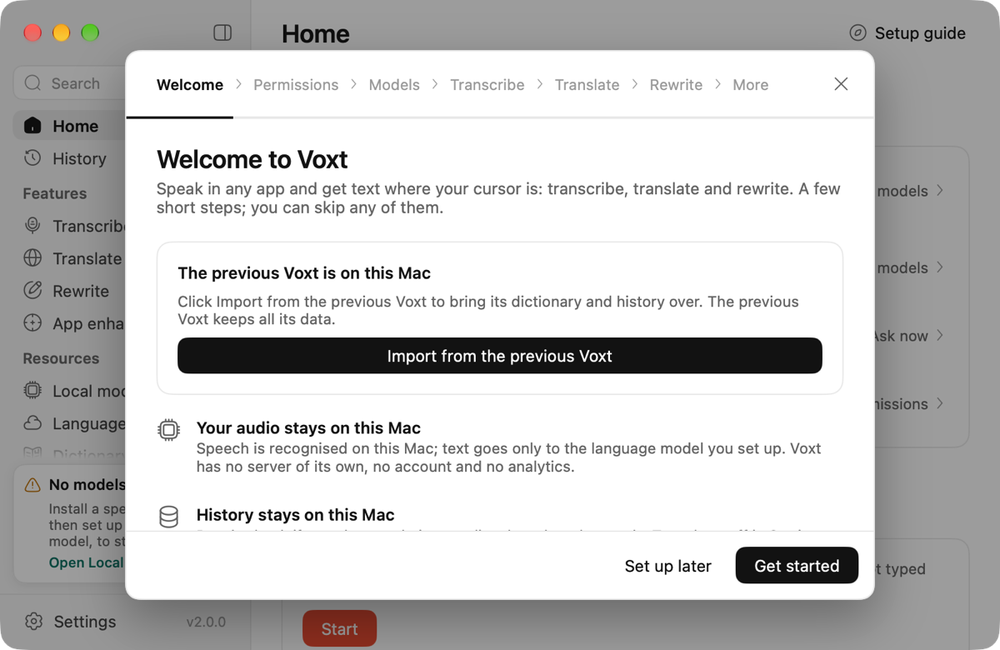
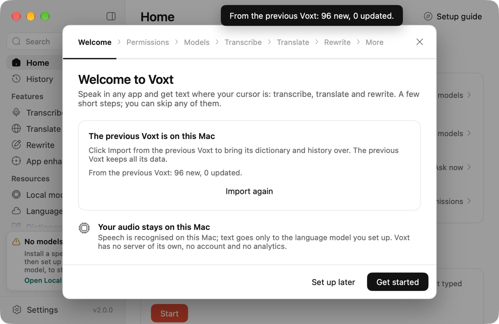
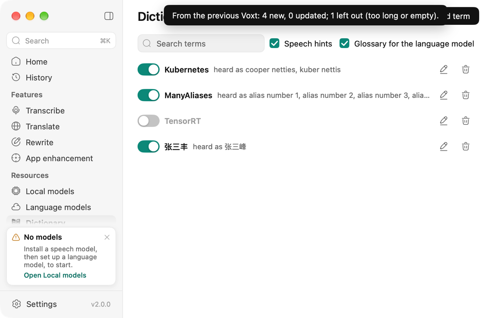
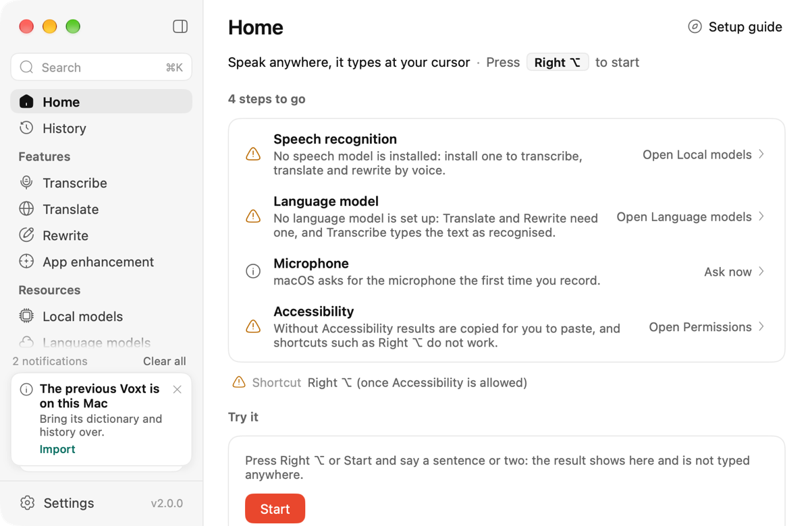
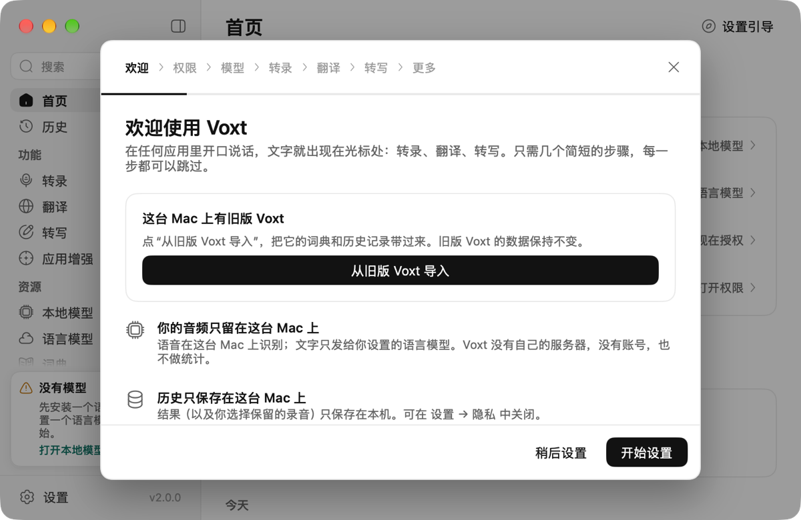

# From Voxt 1.x to Voxt 2

Voxt 2 replaces the Swift Voxt 1.x at `/Applications/Voxt.app`. To macOS they are two apps: Voxt 2's bundle id is `dev.hehehai.voxtnew`, Voxt 1.x's is `com.voxt.Voxt`. Both are signed by the same team, RY2TQTYSKQ. Replacing the app leaves Voxt 1.x's data where it was, in its sandbox container `~/Library/Containers/com.voxt.Voxt`. Voxt 2 imports from there and never writes to it.

## What a user does

1. **Quit Voxt 1.x** from its menu bar icon. If it does not quit, use Force Quit (⌥⌘⎋). Finder cannot replace an app that is running: it says Voxt is in use.
2. **Drag Voxt from the disk image to Applications.** Finder asks what to do with the Voxt already there:
   - **Replace** replaces the app only. Voxt 1.x's data stays, and reinstalling Voxt 1.x brings it back as it was.
   - **Keep Both** installs Voxt 2 as "Voxt 2". Both apps run side by side; their default shortcuts do not overlap (Voxt 1.x: fn, ⇧fn, ⌃fn, ⌥fn; Voxt 2: right Option, right Option with Shift, Control with right Option).
3. **Open Voxt.** The setup guide's first step starts with a card, "The previous Voxt is on this Mac". Click **Import from the previous Voxt**.

   

   - When macOS lets Voxt read Voxt 1.x's data, which it should for the signed release since both apps share a team, the import runs at once.
   - Otherwise an open panel opens on Voxt 1.x's data folder. Click **Import** without changing the folder: that click is the consent macOS asks for, and no other prompt follows.

   
   

4. **Read the result** on the card: how many terms are new or updated, how many history entries and which models came over. The button becomes **Import again**, which adds only what is new.

   
   

5. **Grant the microphone and Accessibility again** in the setup guide's Permissions step. macOS keeps permissions per app, and Voxt 2 is a different app.
6. **Set up a language model** on the Language models page for clean-up, Translate and Rewrite. Voxt 2 no longer runs language models itself, so Voxt 1.x's local language models do not come over: Ollama, LM Studio or oMLX keep the text on this Mac, or pick an online service.

### If you set up 2.0.0 first

Voxt 2.0.0 had no import, and its setup guide does not open again once it is done or skipped. When the previous Voxt's data is on the Mac and the guide will not open, Voxt shows one card in the sidebar; its **Import** runs the import. The card does not come back once dismissed. The import is also in the dictionary's ••• menu, as **Import from the previous Voxt…**.

The setup guide's card in Simplified Chinese:

### Another Mac

On the old Mac, export the dictionary from Voxt 1.x: Dictionary → More → Export. The file is `Voxt-Dictionary.json` (`Voxt-词典.json` in Chinese). On the new Mac, open Voxt's Dictionary → ••• → **Import…** and pick the file. The export holds the terms and their replacement terms only: no history, no models, and no disabled state, so disabled terms come in enabled.

Voxt 2.0.0 reads this file as plain text and adds each line as a term. With 2.0.0, do not import it; if you did, delete the terms that look like JSON (`{`, `"version": 3`, …).

### Going back

Reinstall Voxt 1.16.3 from its release. Its dictionary, history and settings are where Voxt 1.x left them.

## What comes over

| Voxt 1.x (`voxt.sqlite`) | Voxt 2 |
|---|---|
| Dictionary terms | Terms. A term longer than 80 characters, or empty, is left out and counted in the result. |
| Replacement terms | Aliases ("heard as"): the first 10, in order. |
| Disabled terms | Disabled terms. |
| History: dictation, translation, rewrite | Transcribe, Translate and Rewrite entries, with the app, the models, the time and the length. Their ids are `legacy-<old id>`, so importing again adds nothing. |
| History: meeting transcripts | Left out: Voxt 2 has no meetings. |
| Speech models in `model-storage/<owner>_<name>` | Hard-linked into the model library when every file matches the version Voxt pins (size, and SHA-256 for the large files); otherwise left alone, and Voxt downloads them as usual. |
| Language models in `model-storage` | Left alone: Voxt no longer runs language models on this Mac (`legacyReusable` skips retired models). |
| Settings, shortcuts, app enhancement groups, notes | Not imported. |

Terms merge by name, ignoring case: an existing term gains the aliases it lacks. An import that stops halfway, for example when Voxt is force-quit, leaves the database consistent; importing again adds what is missing.

## How it works

`legacy_import.go` holds the import; `legacy_import_test.go` tests it on databases Voxt 1.x wrote (`testdata/legacy`).

- **Finding Voxt 1.x.** `legacyLibrary` checks that the container directory exists. Checking a container's existence needs no permission; reading inside it does. The card and the menu item show only when it exists.
- **Reading without asking.** `legacyReadable` opens Voxt 1.x's `voxt.sqlite` and reads one byte. macOS lets apps signed by the same team read each other's containers, so the signed release should get through and import at once. An ad hoc build is refused with EPERM and no prompt, and falls back to the open panel. Reading a byte, not only finding the file, matters: a container can let a file be found and not opened.
- **The open panel.** It opens on the container's `Data/Library` (`DefaultPath`), and the folder the user picks is readable for the rest of the run. Any of the three levels down to `Application Support/Voxt` works (`legacyDatabase`).
- **The database** is read read-only together with its `-wal` and `-shm`: Voxt 1.x's rows can live only in the WAL, and opening the main file alone does not see them.
- **Models.** `reuseLegacyModels` looks for each catalogue model that `legacyReusable` allows (not borrowed, not retired) under Voxt 1.x's `model-storage`, checks every file, hard-links them into the library and claims them (`Manager.Use`).
- **The cards.** The setup guide's welcome step shows its card on a fresh install. `offerLegacy` posts the sidebar card at start when the guide will not open, once: the document `legacy-import-offered` records that it was posted.
- **Tests and fake homes.** `VOXTNEW_LEGACY_HOME` replaces the home folder the container is looked for in, for tests that run the app with a fake `HOME`.

## Telling Voxt 1.x users

Voxt 1.x shows notices from `https://voxt.actnow.dev/api/app/notifications` (the `voxt-service` repo) in Settings → Notifications, as plain text. A notice is the way to reach users who never visit GitHub: tell them to quit Voxt 1.x before installing Voxt 2, and that Voxt 2 imports their dictionary and history.
