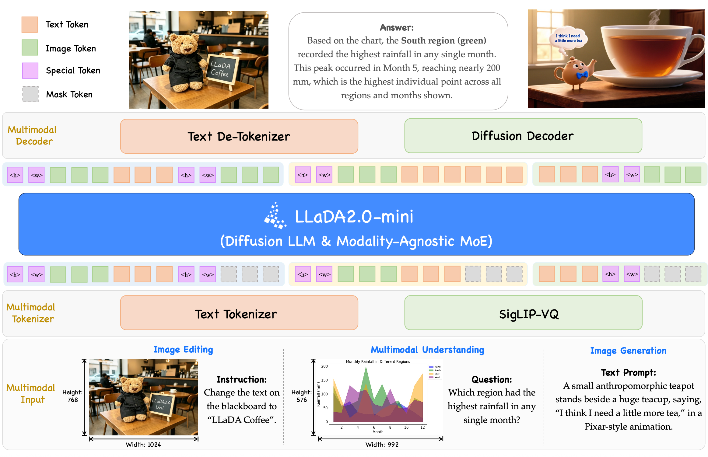

# LLaDA2.0-Uni

[LLaDA2.0-Uni](https://huggingface.co/inclusionAI/LLaDA2.0-Uni) accepts text and image input and supports text output, text-to-image generation, and image editing.

## Highlights

- Unified dLLM-MoE Backbone — Built on LLaDA 2.0, unifying multimodal understanding and generation.
- Top-Tier Understanding & Generation — Matches dedicated VLMs in visual QA and document understanding, while generating high-quality images.
- Interleaved Generation & Reasoning — Empowered by unified discrete representations, unlocking interleaved generation and reasoning.

## Architecture



LLaDA2.0-Uni unifies multimodal understanding and generation into a simple Mask Token Prediction paradigm. Visual inputs are encoded by the SigLIP-VQ tokenizer into discrete semantic tokens, then mapped alongside text tokens to backbone hidden states under a unified mask prediction objective. Output tokens are decoded back to text via the Text De-Tokenizer, or reconstructed into high-fidelity images through the Diffusion Decoder. Empowered by unified discrete representations, it effortlessly handles complex interleaved generation and unlocks advanced interleaved reasoning, interleaving <|image|>...<|/image|> chunks to enable end-to-end training and inference within a single coherent framework.

## Prerequisites

Install `sglang-omni` by following [Installation](../get_started/installation.md).

## Server Configuration

The default `omni` pipeline runs preprocessing, image encoding, and the
DLLM thinker, then routes to text and image decoders. The image decoder
uses diffusers' ZImage backbone, SigVQ conditioning, and a VAE. This is
LLaDA2-Uni's semantic decoder, not the LLaDA-Image text-conditioned model.
The `text` variant retains the four-stage text-output pipeline.

The CFG thinker currently uses synchronous eager execution. An explicit
CUDA graph request is rejected until CFG graph metadata is supported.

```bash
sgl-omni serve --model-path inclusionAI/LLaDA2.0-Uni --port 8000 \
  --thinker.engine.enable_torch_compile false
```

The cookbook explicitly disables `torch.compile` to match the validated
generation settings. CUDA Graph execution is controlled separately.

## Image Generation and Editing

Use `POST /v1/images/generations` for T2I and `POST /v1/images/edits` for
editing. These routes use SGLang Diffusion's image request and response
schemas while executing Omni's Thinker and selected image decoder backend.
`dllm_steps` controls VQ token generation; `num_inference_steps` controls
decoder diffusion sampling. `guidance_scale` sets Thinker CFG, not an
additional CFG pass in the image decoder.

```python
import base64
from pathlib import Path

import requests

request = {
    "model": "inclusionAI/LLaDA2.0-Uni",
    "prompt": "A sailboat on a calm lake.",
    "size": "1024x1024",
    "response_format": "b64_json",
    "decode_mode": "decoder-turbo",
    "num_inference_steps": 8,
    "dllm_steps": 32,
    "guidance_scale": 4.0,
    "seed": 42,
}
response = requests.post(
    "http://localhost:8000/v1/images/generations", json=request, timeout=600
)
response.raise_for_status()
image = response.json()["data"][0]
Path("generated.png").write_bytes(base64.b64decode(image["b64_json"]))
```

Edits accept multipart form data with exactly one `image`/`image[]` upload or
`url`/`url[]` reference. Dimensions follow the processed source grid; omit
`size`, `width`, and `height`. Set `cfg_text_scale` and `cfg_image_scale` for
editing guidance. Omitting them retains the model's task-specific defaults.

```bash
curl http://localhost:8000/v1/images/edits \
  -F 'image=@source.png' \
  -F 'prompt=Change the background to a beach.' \
  -F 'response_format=b64_json' \
  -F 'decode_mode=decoder-turbo' \
  -F 'num_inference_steps=8' \
  -F 'dllm_steps=8' \
  -F 'cfg_text_scale=4.0' -F 'cfg_image_scale=1.5' -F 'seed=42'
```

Both routes are non-streaming, support one PNG (`n=1`), and return
`{id, created, data: [...]}`. `response_format=b64_json` returns raw base64;
`response_format=url` returns an inline PNG data URL without server-side file
retention. T2I accepts either `size` or paired `width`/`height`, defaulting to
1024x1024. Dimensions must be positive multiples of 32; if both forms are
supplied, they must agree. Unsupported native sampling controls are rejected
rather than ignored.
Image endpoints imply image output; no `modalities` field is required.
`/v1/chat/completions` retains text and image-understanding requests; use the
image endpoints for T2I and editing.

The response's `usage` counts prompt and generated tokens, including both
passes in thinking mode.

Text-to-image supports `mode: "normal"` and `mode: "thinking"`. Editing supports
only `mode: "normal"`. Generation mode is separate from `decode_mode`, which
selects `normal` or `decoder-turbo` diffusion decoding.
For normal decoding, `num_inference_steps` specifies at least two sampling
points, giving `num_inference_steps - 1` solver intervals. For decoder-turbo, it specifies at
least one decoder iteration. The examples use eight turbo iterations.
When `decode_mode` is omitted, validation uses the decoder factory's configured
mode, so a turbo factory accepts `num_inference_steps=1` without a mode override.

Common controls include `seed`, `cfg_rescale`, and `dllm_steps`. T2I uses
`guidance_scale` (the thinker's `cfg_scale`); editing uses `cfg_text_scale` and
`cfg_image_scale`. `resolution_multiplier` is a decoder factory setting, not a
request field. Its default value of 2 maps the semantic grid to output pixels.

The server selects a patch-aligned source grid near a 512x512 pixel budget,
then resizes proportionally and center-crops the image to that grid. Small
images are enlarged without black padding; images already matching the grid
are preserved. Aspect ratios beyond 4:1 or 1:4 require additional cropping.
Image understanding retains its separate preprocessing and pixel budgets.

## Thinking Image Generation

Use the same `POST /v1/images/generations` endpoint with top-level
`mode: "thinking"`. For example, add it to the T2I request above:

```python
request["mode"] = "thinking"
response = requests.post(
    "http://localhost:8000/v1/images/generations", json=request, timeout=600
)
response.raise_for_status()
Path("thinking.png").write_bytes(
    base64.b64decode(response.json()["data"][0]["b64_json"])
)
```

The thinker first generates text with a 2048-token budget, stopping at
`<boi>`. It then retains that context and generates the requested VQ grid
with CFG before image decoding. Both phases must fit the configured context
length. The native response remains `data[]` containing one PNG; it does not
expose the thinking text. No `modalities` field is needed. Thinking-mode
editing is unsupported, and chat completions remain for understanding.

## Interleaved Output

The interleaved variant answers with text and images in one response. Each
image decodes while the model writes the next text.

```bash
sgl-omni serve --model-path inclusionAI/LLaDA2.0-Uni --variant interleaved --port 8000 \
  --thinker.engine.enable_torch_compile false
```

Send text-only `messages` to `POST /v1/chat/completions`:

```python
import requests

response = requests.post(
    "http://localhost:8000/v1/chat/completions",
    json={
        "model": "inclusionAI/LLaDA2.0-Uni",
        "messages": [{"role": "user", "content": "Illustrate a three-frame story"}],
        "stage_params": {"orchestrator": {"max_frames": 3, "seed": 42}},
    },
    timeout=1800,
)
segments = response.json()["choices"][0]["message"]["segments"]
```

`choices[0].message.segments` lists the text and image segments in the order
the model wrote them, and `message.content` holds the text. With
`stream: true`, each segment arrives in `choices[0].delta.segment` as soon as it
is ready. An image segment carries the PNG with its size and SHA-256, and `url` is a
PNG data URL:

```json
{
  "type": "segment",
  "execution_id": "...",
  "segment_index": 1,
  "kind": "image",
  "data": {
    "kind": "image",
    "mime_type": "image/png",
    "size_bytes": 12345,
    "sha256": "...",
    "url": "..."
  }
}
```

Optional controls go in `stage_params.orchestrator`: `max_frames` (default
10, the most the default server admits), `text_max_new_tokens`,
`image_max_new_tokens`, `max_image_tokens`, `dllm_steps`, `cfg_scale`,
`cfg_text_scale`, `cfg_image_scale`, `cfg_rescale`, `decode_mode`,
`decoder_steps`, and `seed`.

## Text Input

Send a text-only prompt and get a text response.

**cURL**

```bash
curl -X POST http://localhost:8000/v1/chat/completions \
  -H "Content-Type: application/json" \
  -d '{
    "model": "inclusionAI/LLaDA2.0-Uni",
    "messages": [{"role": "user", "content": "Hello!"}],
    "max_tokens": 256
  }'
```

**Python**

```python
import requests

resp = requests.post(
    "http://localhost:8000/v1/chat/completions",
    json={
        "model": "inclusionAI/LLaDA2.0-Uni",
        "messages": [{"role": "user", "content": "Hello!"}],
        "max_tokens": 256,
    },
)
resp.raise_for_status()
result = resp.json()
print(result["choices"][0]["message"]["content"])
```

## Image and Text Input

Send an image with a text prompt to get a text response.

**cURL**

```bash
curl -X POST http://localhost:8000/v1/chat/completions \
  -H "Content-Type: application/json" \
  -d '{
    "model": "inclusionAI/LLaDA2.0-Uni",
    "messages": [{"role": "user", "content": "Briefly describe the cars in this image."}],
    "images": ["tests/data/cars.jpg"],
    "modalities": ["text"],
    "max_tokens": 16
  }'
```

**Python**

```python
import requests

resp = requests.post(
    "http://localhost:8000/v1/chat/completions",
    json={
        "model": "inclusionAI/LLaDA2.0-Uni",
        "messages": [{"role": "user", "content": "Briefly describe the cars in this image."}],
        "images": ["tests/data/cars.jpg"],
        "modalities": ["text"],
        "max_tokens": 16,
    },
)
resp.raise_for_status()
result = resp.json()
print(result["choices"][0]["message"]["content"])
```

Images can also be passed inline using the OpenAI multi-content format:

```python
import requests

resp = requests.post(
    "http://localhost:8000/v1/chat/completions",
    json={
        "model": "inclusionAI/LLaDA2.0-Uni",
        "messages": [
            {
                "role": "user",
                "content": [
                    {"type": "image_url", "image_url": {"url": "tests/data/cars.jpg"}},
                    {"type": "text", "text": "Briefly describe the cars in this image."},
                ],
            }
        ],
        "modalities": ["text"],
        "max_tokens": 16,
    },
)
resp.raise_for_status()
result = resp.json()
print(result["choices"][0]["message"]["content"])
```

## Request Parameters

The table below lists common text and image-understanding parameters for
`/v1/chat/completions`.

| Parameter | Type | Default | Description |
|---|---|---|---|
| `model` | string | `null` | Model identifier |
| `messages` | list | (required) | List of chat messages, each with `role` and `content` |
| `modalities` | list | `["text"]` | Use `["text"]` for text and image understanding |
| `images` | list | `null` | List of image file paths (local paths or URLs) |
| `max_tokens` | int | `null` | Maximum number of tokens to generate |

## Known Limitations

- Image generation and editing return one image per non-streaming request.
- Thinking mode supports text-to-image only.
- Interleaved output takes text-only input.
