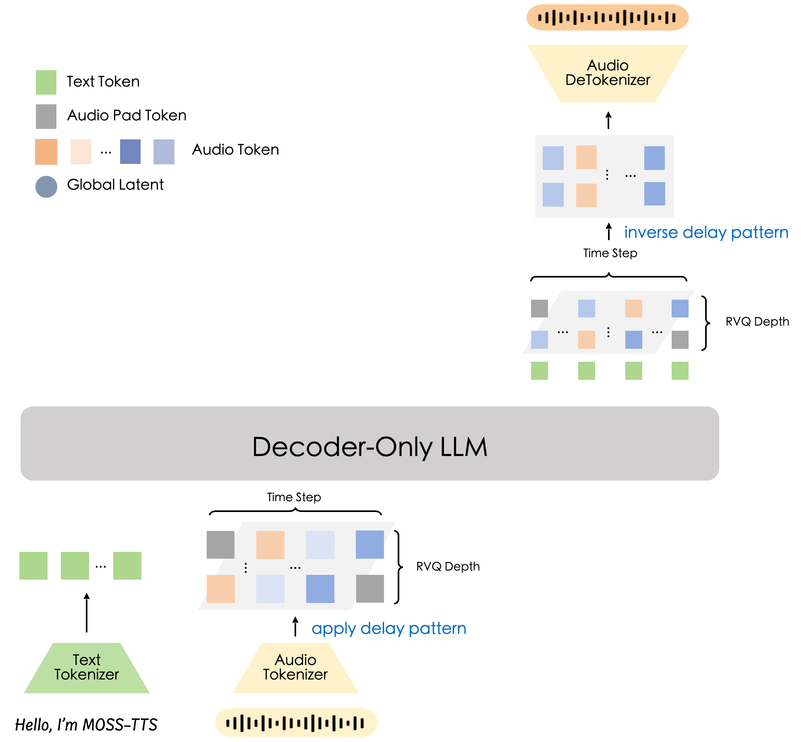

# MOSS-TTS

[MOSS-TTS-v1.5](https://huggingface.co/OpenMOSS-Team/MOSS-TTS-v1.5) is a delay-pattern text-to-speech model from MOSI.AI and the OpenMOSS team. It reconstructs **24 kHz** speech and supports zero-shot voice cloning from reference audio, reference-less synthesis, long-form speech generation, streaming, token-level duration control, Pinyin/IPA pronunciation control, multilingual synthesis, and code-switching. The model supports **31 languages**, accepts language tags to guide multilingual generation, and supports inline pause markers such as `[pause 3.2s]` for explicit prosody control.



Architecturally, MOSS-TTS-v1.5 is the `delay-pattern` counterpart to [MOSS-TTS-Local-Transformer-v1.5](moss_tts_local.md). The Qwen3-8B backbone predicts one text stream plus 32 residual-vector-quantization (RVQ) audio codebooks with delay-pattern scheduling; the generated codes are de-delayed and reconstructed into waveform by the vocoder. In SGLang-Omni it runs as a `preprocessing → tts_engine → vocoder` pipeline served through the OpenAI-compatible `/v1/audio/speech` endpoint.

| Component | Spec |
|---|---|
| Architecture | `MossTTSDelayModel` (`moss_tts_delay`) |
| Backbone | Qwen3-8B autoregressive decoder (36 L, hidden=4096, GQA 32/8) |
| Audio tokens | 32-codebook RVQ depth with delay-pattern scheduling |
| Output audio | 24 kHz |
| Languages | 31 languages with optional language tags |
| Controls | Voice reference, target duration tokens, Pinyin/IPA, pause markers, style instructions |

## Prerequisites

For CUDA, install `sglang-omni` by following [Installation](../get_started/installation.md). For Ascend, use the installation profile below. Download the model (public, no token required):

```bash
hf download OpenMOSS-Team/MOSS-TTS-v1.5
```

The processor ships with the checkpoint, so no extra TTS package is needed. Decoding base64
(data-URI) reference audio additionally requires `soundfile` (`uv pip install soundfile`).

### Ascend NPU

The tested single-card profile uses BF16 MOSS-TTS-v1.5 on a 64 GB Ascend910_9362, PyTorch/torch_npu 2.10, CANN 9.0 and released SGLang 0.5.21. Backbone decode and sampling graphs are enabled.

Start from an Ascend environment with the NPU runtime and Omni's audio dependencies installed; see [Ascend prerequisites](../get_started/installation_npu.md#prerequisites). The repository's NPU installer and images currently target SGLang 0.5.20, so that installer does not install this tested profile. In the prepared environment, install the released package and this checkout explicitly, preserving the existing Ascend dependencies:

```bash
python -m pip install 'setuptools>=77'
python -m pip install --no-deps 'sglang==0.5.21'
python -m pip install --no-deps --no-build-isolation -e .
```

These commands install the Python packages; they require an existing compatible CANN, PyTorch, torch_npu, triton-ascend and sgl-kernel-npu stack. No SGLang source patch is required.

Set the following before starting the server:

```bash
export ASCEND_RT_VISIBLE_DEVICES=0
export SGLANG_OMNI_PLATFORM_SPEC=sglang_omni.platforms.npu.NPUOmniPlatform
export PER_STREAM_QUEUE=1
export TASK_QUEUE_ENABLE=1
```

Keep both queue settings for this profile. `PER_STREAM_QUEUE` is an [experimental torch_npu option](https://www.hiascend.com/document/detail/en/Pytorch/2610/devguide/fwfeatures/docs/en/framework_feature_guide_pytorch/stream_taskqueue_parallel_delivery.md) used by the validated concurrent reference-encoding and graph workload; check the profile on your deployment.

Download `OpenMOSS-Team/MOSS-Audio-Tokenizer` as well as the TTS checkpoint.
For local weights, create `npu-moss.yaml`:

```yaml
config_cls: MossTTSPipelineConfig
model_path: /models/MOSS-TTS-v1.5
stages:
  preprocessing:
    factory:
      codec_model_path: /models/MOSS-Audio-Tokenizer
  vocoder:
    factory:
      codec_model_path: /models/MOSS-Audio-Tokenizer
```

Start the server, then use the speech requests below:

```bash
sgl-omni serve --model-path /models/MOSS-TTS-v1.5 --config npu-moss.yaml --port 8000
```

## Server Configuration

The pipeline is `preprocessing → tts_engine → vocoder`. By default the vocoder
runs in its own process (GPU memory fractions 0.10 / 0.72 / 0.18 for the three
stages): its Python decode loop no longer shares the interpreter with the AR
scheduler, which on H200 lifts single-replica throughput by about 70% at every
concurrency cap. `config_cls: MossTTSSingleProcessPipelineConfig` restores the
single-process layout; the bounded 24 GB and 32 GB configurations keep it.

```bash
sgl-omni serve \
  --model-path OpenMOSS-Team/MOSS-TTS-v1.5 \
  --config examples/configs/moss_tts.yaml \
  --port 8000
```

The default model-specific layout places the repository-local encoder and
vocoder components on the configured pipeline GPU. The encoder and decoder
weights materialize in BF16 according to `compute_dtype`; the quantizers and
explicit FP32 norms remain in FP32. Each stage constructs only the codec
components it uses instead of loading a complete codec copy.

The bounded 24 GB and 32 GB configurations explicitly move preprocessing to
CPU. They retain BF16 compute unless `compute_dtype` is overridden.

Speech input admission follows the text backbone's context metadata rather than
the generic 4,096-character precheck. Requests that exceed the effective model
context are rejected with an OpenAI-compatible HTTP 400 error.

For the bounded 32 GB qualification layout, use:

```bash
sgl-omni serve \
  --model-path OpenMOSS-Team/MOSS-TTS-v1.5 \
  --config examples/configs/moss_tts_32gb.yaml \
  --port 8000
```

This configuration limits request concurrency and CUDA Graph capture to batch
size 1. It completed startup and reference-less non-streaming synthesis on one
RTX 5090 with 32,607 MiB, peaking at 26,939 MiB. Treat this as a measured
qualification point rather than a general claim for every 32 GB card.

For the directly measured 24 GB layout, use:

```bash
sgl-omni serve \
  --model-path OpenMOSS-Team/MOSS-TTS-v1.5 \
  --config examples/configs/moss_tts_24gb.yaml \
  --port 8000
```

This profile completed startup, CUDA Graph capture, reference and
reference-less synthesis, streaming, cancellation, and recovery on one RTX
4090 with 24,564 MiB. Peak sampled VRAM was 23,251 MiB, leaving a minimum of
960 MiB free. SGLang profiled an effective 6,708-token KV capacity below the
requested `max_total_tokens: 8192`. Treat this as a concurrency-1,
CUDA-Graph-cap-1 qualification point, not a broader 24 GB capacity claim.

Both policies can be changed explicitly through the preprocessing/vocoder
stages' `factory.*` entries when profiling another layout. Explicit `device`
values take precedence over the GPU selected by stage placement.

## Synthesizing Speech

### Basic Speech

MOSS-TTS can synthesize speech without a reference clip:

```bash
curl -X POST http://localhost:8000/v1/audio/speech \
  -H "Content-Type: application/json" \
  -d '{
    "model": "OpenMOSS-Team/MOSS-TTS-v1.5",
    "voice": "default",
    "input": "SGLang-Omni is a great project!"
  }' \
  --output output.wav
```

### Voice Cloning

Provide a reference clip when you want voice cloning. The `references` field accepts `audio_path`
(a local path, HTTP URL, or base64 data URI) and `text` (the transcript of that clip). Supplying
the transcript materially improves cloning quality.

```bash
curl -X POST http://localhost:8000/v1/audio/speech \
  -H "Content-Type: application/json" \
  -d '{
    "model": "OpenMOSS-Team/MOSS-TTS-v1.5",
    "voice": "default",
    "input": "SGLang-Omni is a great project!",
    "references": [{
      "audio_path": "https://huggingface.co/datasets/zhaochenyang20/seed-tts-eval-mini/resolve/main/en/prompt-wavs/common_voice_en_10119832.wav",
      "text": "We asked over twenty different people, and they all said it was his."
    }]
  }' \
  --output output.wav
```

`ref_audio` and `ref_text` are accepted as shorthand for `references[0].audio_path` and
`references[0].text`.

#### Python

```python
import requests

resp = requests.post(
    "http://localhost:8000/v1/audio/speech",
    json={
        "model": "OpenMOSS-Team/MOSS-TTS-v1.5",
        "voice": "default",
        "input": "Get the trust fund to the bank early.",
        "ref_audio": "https://huggingface.co/datasets/zhaochenyang20/seed-tts-eval-mini/resolve/main/en/prompt-wavs/common_voice_en_10119832.wav",
        "ref_text": "We asked over twenty different people, and they all said it was his.",
    },
)
resp.raise_for_status()
with open("output.wav", "wb") as f:
    f.write(resp.content)
```

### Reference Audio Sources

`audio_path` / `ref_audio` may be a local filesystem path readable by the server, an HTTP(S)
URL, or a base64 **data URI** (`data:audio/wav;base64,<...>`, decoded with `soundfile`):

```json
{"ref_audio": "data:audio/wav;base64,UklGR.....", "ref_text": "Transcript of the clip."}
```

### Streaming

Set `"stream": true` and `"response_format": "pcm"` to receive raw PCM audio
chunks in real time.

```bash
curl -N -X POST http://localhost:8000/v1/audio/speech \
  -H "Content-Type: application/json" \
  -d '{
    "model": "OpenMOSS-Team/MOSS-TTS-v1.5",
    "voice": "default",
    "input": "Get the trust fund to the bank early.",
    "ref_audio": "https://huggingface.co/datasets/zhaochenyang20/seed-tts-eval-mini/resolve/main/en/prompt-wavs/common_voice_en_10119832.wav",
    "ref_text": "We asked over twenty different people, and they all said it was his.",
    "stream": true,
    "response_format": "pcm"
  }' \
  --output output.pcm
```

### Duration Control

MOSS-TTS conditions on a target **duration token count** (codec frames; a larger count yields
longer audio). Set it with an inline `${token:N}` prefix on `input` (stripped before synthesis),
or with a `token_count` (alias `duration_tokens` / `tokens`) parameter. The count must be a
positive integer.

```json
{
  "model": "OpenMOSS-Team/MOSS-TTS-v1.5",
  "voice": "default",
  "input": "${token:150}A sentence with an explicit duration target.",
  "ref_audio": "..."
}
```

If omitted, the model picks a duration on its own; the SeedTTS benchmark estimates one per
sample with `--token-count auto`.

### Text Markup, Style, and Language

Inline text markup that the model understands (for example `[pause Xs]`, pinyin, and IPA) is
passed through unchanged. An optional `instructions` (alias `instruct`) field carries a
free-text style directive, and an optional `language` hint biases the target language (omit it
to let the model infer from the text):

```json
{
  "model": "OpenMOSS-Team/MOSS-TTS-v1.5",
  "voice": "default",
  "input": "今天天气不错 [pause 0.5s] 就该出去晒晒太阳。",
  "ref_audio": "...", "ref_text": "...",
  "language": "Chinese",
}
```

## Generation Parameters

| Parameter | Default | Notes |
|---|---|---|
| `model` | served model | Served model identifier |
| `input` | (required) | Text to synthesize. It may carry a `${token:N}` duration prefix and inline markup |
| `voice` | `default` | Voice identifier |
| `references` | `null` | Reference clip for cloning. Each item has `audio_path` and `text` |
| `ref_audio` / `ref_text` | `null` | Shorthand for `references[0].audio_path` / `references[0].text` |
| `stream` | `false` | Stream raw PCM audio chunks |
| `language` | `null` | Optional target-language hint. Omit to let the model infer |
| `instructions` / `instruct` | `null` | Optional free-text style directive |
| `token_count` / `duration_tokens` / `tokens` | `null` | Target duration in codec frames. It must be `> 0` |
| `max_new_tokens` | `4096` | Maximum generated frames. An explicit value must be `> 0` |
| `temperature` | `1.5` text / `1.7` audio | Sampling temperature. A single `temperature` overrides both channels |
| `top_p` | `1.0` text / `0.8` audio | Top-p sampling. A single `top_p` overrides both channels |
| `top_k` | `50` text / `25` audio | Top-k sampling. A single `top_k` overrides both channels |
| `repetition_penalty` | `1.0` | Audio repetition penalty |
| `seed` | `null` | Non-negative integer. See [Seed Reproducibility](#seed-reproducibility) |

The per-channel fields (`text_temperature`, `audio_temperature`, `text_top_p`, `audio_top_p`,
`text_top_k`, `audio_top_k`, `audio_repetition_penalty`) are also accepted and take precedence
over the single-value aliases.

## Seed Reproducibility

MOSS-TTS samples each row, position, and codebook with `multinomial_with_seed`, deriving a
per-request seed from the public `seed` and combining it with a per-(step, channel) position. A
sampling noise therefore depends on its own seed, position, and token identity,
independently of batch neighbours. With identical logits and prepared inputs,
the sampler reproduces its selection across batches.
Limitations:

- Reproducibility holds for a **fixed server configuration and hardware**. Floating-point
  differences in reference encoding and the backbone (different batch shapes,
  device models, or kernels) can change prepared codes or logits, and thus the
  sampled tokens. A fixed seed does not guarantee identical end-to-end audio
  across concurrency settings or deployments.
- `seed` must be a non-negative integer; non-integer or negative values are rejected.
- Requests **without** a `seed` draw a fresh random per-request seed, so they are not
  reproducible across runs (but are still independent of batch neighbours).

## Benchmarking

MOSS-TTS clones from each prompt (`--ref-format references`) and estimates a per-sample duration
with `--token-count auto`. Run at `--max-concurrency 8`; higher concurrency regresses WER.

```bash
python -m benchmarks.eval.benchmark_tts_seedtts \
  --meta zhaochenyang20/seed-tts-eval-arrow \
  --model OpenMOSS-Team/MOSS-TTS-v1.5 --port 8000 \
  --ref-format references --token-count auto \
  --output-dir results/moss_tts_en --lang en --max-concurrency 8
```

Use `--lang zh` for the Chinese split. See `benchmarks/README.md` for the full workflow.

## Benchmark Results

Seed-TTS-Eval full set (EN = 1088, ZH = 2020) on 1× H200, concurrency 8, `--token-count auto`.
WER is scored with HF Whisper-large-v3 (EN) / FunASR paraformer-zh (ZH). These are the reference
numbers tabulated in `benchmarks/eval/benchmark_tts_seedtts.py` (source: PR #609) — reproducible
references, not CI thresholds.

| Lang | WER (corpus) | WER (excl. >50%) | Latency mean / p95 (s) | RTF mean | Throughput (qps) |
|---|---|---|---|---|---|
| EN | 1.68% | 1.32% (4 outliers) | 3.449 / 4.141 | 0.811 | 2.312 |
| ZH | 1.36% | 1.27% (2 outliers) | 3.608 / 4.153 | 0.635 | 2.213 |

A handful of utterances in the H200 reference run away into a repetition loop (> 50% WER) and dominate the raw
micro-average; excluding them, corpus WER is ~1.3% in both languages, and per-sample median WER
is 0.00%.

The Ascend profile above completed all 1088 EN samples with seed 1234, concurrency 8, eight warmup requests, reference audio/text and automatic duration tokens. HF Whisper-large-v3 FP32 scored every output; generation and scoring each had zero failures.

| Device | Lang | WER (corpus) | WER (excl. >50%) | Latency mean / p95 (s) | RTF mean | Throughput (qps) |
|---|---|---|---|---|---|---|
| Ascend910_9362 | EN | 212/11943 = 1.7751% | 184/11913 = 1.5445% (4 outliers) | 5.583 / 7.045 | 1.2827 | 1.431 |

All four severe samples remain in the primary WER; their cause is unresolved. Hardware, software and recorded seed conditions differ from the historical H200 reference, so this is not a matched hardware comparison.

## Known Limitations

- **Voice cloning depends on the reference.** Omit the reference for non-cloned speech; provide
  the transcript (`text` / `ref_text`) for the best speaker similarity when cloning.
- **Concurrency vs. WER.** Quality is best around `--max-concurrency 8`; higher concurrency
  regresses WER.
- **Rare runaway generation.** A small fraction of utterances can loop and generate up to
  `max_new_tokens`; setting a `token_count` (or lowering `max_new_tokens`) bounds the output.
- **Duration is a hint.** `${token:N}` / `token_count` steers length but is not an exact clip
  duration.
