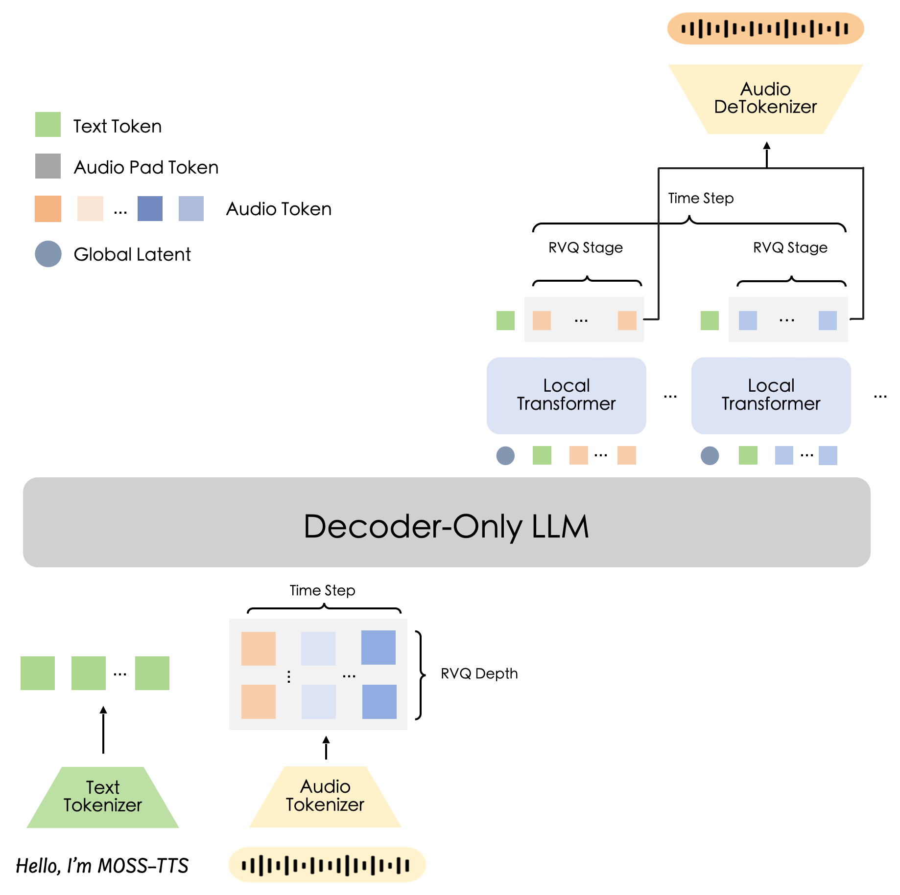

# MOSS-TTS-Local

[MOSS-TTS-Local-Transformer-v1.5](https://huggingface.co/OpenMOSS-Team/MOSS-TTS-Local-Transformer-v1.5) is a text-to-speech model from MOSI.AI and the OpenMOSS team. It generates native **48 kHz stereo** speech with [MOSS-Audio-Tokenizer-v2](https://huggingface.co/OpenMOSS-Team/MOSS-Audio-Tokenizer-v2) and supports zero-shot voice cloning from reference audio, reference-less synthesis, long-form speech generation, streaming, token-level duration control, Pinyin/IPA pronunciation control, multilingual synthesis, and code-switching. The model supports **31 languages**, accepts language tags to guide multilingual generation, and supports inline pause markers such as `[pause 3.2s]` for explicit prosody control.



Architecturally, MOSS-TTS-Local-Transformer-v1.5 is the `local-transformer` counterpart to the `delay-pattern` [MOSS-TTS-v1.5](moss_tts.md). Instead of staggering RVQ streams across time, the Qwen3-4B backbone emits a global latent for each aligned audio frame, and a lightweight frame-local transformer expands that latent into a fixed 12-codebook RVQ block. In SGLang-Omni it runs as a `preprocessing → tts_engine → vocoder` pipeline served through the OpenAI-compatible `/v1/audio/speech` endpoint.

| Component | Spec |
|---|---|
| Architecture | `MossTTSLocalModel` (`moss_tts_local`) |
| Backbone | Qwen3-4B autoregressive decoder (36 L, hidden=2560, GQA 32/8) |
| Audio tokenizer | MOSS-Audio-Tokenizer-v2 |
| Audio tokens | Fixed 12-codebook RVQ depth |
| Output audio | 48 kHz stereo |
| Languages | 31 languages with optional language tags |
| Controls | Voice reference, target duration tokens, Pinyin/IPA, pause markers, style instructions |

## Prerequisites

Install `sglang-omni` by following [Installation](../get_started/installation.md), then
download the model (public, no token required):

```bash
hf download OpenMOSS-Team/MOSS-TTS-Local-Transformer-v1.5
```

The processor ships with the checkpoint, so no extra TTS package is needed. Decoding base64
(data-URI) reference audio additionally requires `soundfile` (`uv pip install soundfile`).

## Server Configuration

The default layout runs preprocessing, the AR backbone, and the vocoder in
separate processes on the same GPU. MPS defaults to `auto`, enabling CUDA MPS
when the device and process layout support it:

```bash
sgl-omni serve \
  --model-path OpenMOSS-Team/MOSS-TTS-Local-Transformer-v1.5 \
  --port 8000
```

A matching config file is available at `examples/configs/moss_tts_local.yaml`.

Speech input admission follows the text backbone's context metadata rather than
the generic 4,096-character precheck. Requests that exceed the effective model
context are rejected with an OpenAI-compatible HTTP 400 error.

### Streaming vocoder CUDA graphs

The `vocoder_cuda_graph` pipeline setting controls CUDA graphs for MOSS-Audio-Tokenizer streaming decode. AR engine graph settings are configured separately under `tts_engine.engine`.

| Pipeline setting | Default | Purpose |
| --- | --- | --- |
| `vocoder_cuda_graph` | `null` | Use the platform default: enabled except on ROCm WSL/DXG. Set `false` for eager streaming vocoder decode. |
| `vocoder_cuda_graph_frames` | `null` | Override the audio-code frame counts captured by the streaming vocoder. |
| `vocoder_cuda_graph_min_free_gb` | `3.0` | Minimum free GPU memory before vocoder graph capture; `0` disables this check. |

For non-streaming workloads, set `vocoder_cuda_graph: false` in YAML or pass `--vocoder_cuda_graph false` to leave more GPU memory available for decoding. A complete example is available at `examples/configs/moss_tts_local_non_streaming.yaml`.

The same names are used by the pipeline configuration and the vocoder factory/scheduler APIs. Replace the former `cuda_graph`, `cuda_graph_frames`, and `cuda_graph_min_free_gb` spellings in YAML, CLI overrides, and direct Python calls with the `vocoder_` prefix.

## Synthesizing Speech

### Basic Speech

MOSS-TTS-Local can synthesize speech without a reference clip:

```bash
curl -X POST http://localhost:8000/v1/audio/speech \
  -H "Content-Type: application/json" \
  -d '{
    "model": "OpenMOSS-Team/MOSS-TTS-Local-Transformer-v1.5",
    "voice": "default",
    "input": "SGLang-Omni is a great project!"
  }' \
  --output output.wav
```

The [TTS client examples](../basic_usage/tts.md#python) cover the Python and OpenAI SDK clients for the same request.

### Voice Cloning

MOSS-TTS-Local clones from a reference clip, and supplying the clip's transcript in `references[0].text` (or `ref_text`) materially improves speaker similarity. See [Voice cloning in TTS Model Usage](../basic_usage/tts.md#voice-cloning) for the request fields, the reference sources the server accepts, and a client example. Reference encodes are cached (LRU) and coalesced into batched codec calls, so resending the same clip skips re-encoding.

### Streaming

MOSS-TTS-Local streams 48 kHz PCM. Add `"stream": true` with `"response_format": "pcm"` to a speech request; the shared raw PCM and SSE clients are in [TTS Model Usage](../basic_usage/tts.md#streaming). To write a playable WAV, pipe the response body through `ffmpeg -f s16le -ar 48000 -ac 1 -i pipe:0 output.wav`.

### Duration Control

MOSS-TTS-Local conditions on a target **duration token count** (codec frames; a larger count yields longer audio). Set it with an inline `${token:N}` prefix on `input` (stripped before synthesis), or with a `token_count` (alias `duration_tokens`) parameter. The count must be a positive integer.

```json
{
  "model": "OpenMOSS-Team/MOSS-TTS-Local-Transformer-v1.5",
  "voice": "default",
  "input": "${token:150}A sentence with an explicit duration target.",
  "ref_audio": "..."
}
```

```bash
curl -X POST http://localhost:8000/v1/audio/speech \
  -H "Content-Type: application/json" \
  -d '{
    "model": "OpenMOSS-Team/MOSS-TTS-Local-Transformer-v1.5",
    "voice": "default",
    "input": "${token:150}A sentence with an explicit duration target.",
    "ref_audio": "https://huggingface.co/datasets/zhaochenyang20/seed-tts-eval-mini/resolve/main/en/prompt-wavs/common_voice_en_10119832.wav",
    "ref_text": "We asked over twenty different people, and they all said it was his."
  }' \
  --output output_duration_tokens.wav
```

If omitted, the model picks the duration itself.

### Text Markup, Style, and Language

Inline text markup that the model understands (for example `[pause Xs]`, pinyin, and IPA) is passed through unchanged. An optional `instructions` field carries a
free-text style directive, and an optional `language` hint biases the target language (omit it to let the model infer from the text):

```json
{
  "model": "OpenMOSS-Team/MOSS-TTS-Local-Transformer-v1.5",
  "voice": "default",
  "input": "今天天气不错 [pause 0.5s] 就该出去晒晒太阳。",
  "ref_audio": "...", "ref_text": "...",
  "language": "Chinese"
}
```

```bash
curl -X POST http://localhost:8000/v1/audio/speech \
  -H "Content-Type: application/json" \
  -d '{
    "model": "OpenMOSS-Team/MOSS-TTS-Local-Transformer-v1.5",
    "voice": "default",
    "input": "今天天气不错 [pause 0.5s] 就该出去晒晒太阳。",
    "ref_audio": "https://huggingface.co/datasets/zhaochenyang20/seed-tts-eval-mini/resolve/main/en/prompt-wavs/common_voice_en_10119832.wav",
    "ref_text": "We asked over twenty different people, and they all said it was his.",
    "language": "Chinese",
    "instructions": "Use a natural conversational style."
  }' \
  --output output_markup.wav
```

## Generation Parameters

| Parameter | Default | Notes |
|---|---|---|
| `model` | served model | Served model identifier |
| `input` | (required) | Text to synthesize. It may carry a `${token:N}` duration prefix and inline markup |
| `voice` | `default` | Voice identifier |
| `references` | `null` | Reference clip for cloning. Each item has `audio_path` and `text` |
| `ref_audio` / `ref_text` | `null` | Shorthand for `references[0].audio_path` / `references[0].text` |
| `stream` | `false` | Stream raw PCM audio chunks (with `response_format: pcm`) |
| `language` | `null` | Optional target-language hint. Omit to let the model infer |
| `instructions` | `null` | Optional free-text style directive |
| `token_count` / `duration_tokens` | `null` | Target duration in codec frames. It must be `> 0` |
| `max_new_tokens` | `4096` | Maximum generated frames. An explicit value must be `> 0` |
| `temperature` | `1.0` text / `1.7` audio | Sampling temperature. A single `temperature` overrides both channels |
| `top_p` | `1.0` text / `0.8` audio | Top-p sampling. A single `top_p` overrides both channels |
| `top_k` | `50` text / `25` audio | Top-k sampling. A single `top_k` overrides both channels |
| `repetition_penalty` | `1.0` | Audio repetition penalty |
| `seed` | `null` | Non-negative integer. See [Seed Reproducibility](#seed-reproducibility) |

The two default values reflect the model's separate sampling channels: the `text` channel is the
per-frame continue/stop head and the `audio` channel is the RVQ codebooks. A single `temperature`,
`top_p`, or `top_k` in the request applies to both.

## Seed Reproducibility

A fixed `seed` is reproducible at **any concurrency**: each token's sampling depends only on its
own seed and position, never on its batch neighbours.

- Reproducibility holds for a **fixed server configuration and hardware** — backbone
  floating-point non-determinism (different batch shapes, GPUs, or kernels) can still shift the
  sampled tokens across deployments.
- `seed` must be a non-negative integer; negative or non-integer values are rejected.
- Without a `seed`, each request draws a fresh random seed and is not reproducible across runs.

## Benchmarking

MOSS-TTS-Local clones from each prompt (`--ref-format references`) and estimates a per-sample
duration with `--token-count auto`. Run at `--max-concurrency 16`.

```bash
python -m benchmarks.eval.benchmark_tts_seedtts \
    --meta zhaochenyang20/seed-tts-eval-arrow \
    --model OpenMOSS-Team/MOSS-TTS-Local-Transformer-v1.5 --port 8000 \
    --ref-format references \
    --token-count auto \
    --output-dir results/moss_tts_en \
    --lang en --max-concurrency 16
```

Use `--lang zh` for the Chinese split. See `benchmarks/README.md` for the full workflow.

## Evaluation Benchmarks

### Seed-TTS-Eval Reference Performance

Seed-TTS-Eval full set (EN = 1088, ZH = 2020) on 2× H100, concurrency 16,
`--token-count auto`. These are reference inference-performance numbers reported
in PR #728 — reproducible references, not CI thresholds.

| Split | Latency mean / p95 (s) | RTF mean | Throughput (req/s) |
|---|---:|---:|---:|
| EN | 1.538 / 1.989 | 0.3682 | 10.355 |
| ZH | — | 0.3306 | 8.62 |

### Multilingual Voice Clone

We evaluate MOSS-TTS-Local-Transformer-v1.5 on public multilingual TTS suites and
internal voice-cloning stress sets, covering multilingual synthesis, speaker
similarity, and hard speaker-stability cases.

WER (↓) and SIM (↑) are macro-averaged and reported in percentage points. `N/A`
means the benchmark is speaker-similarity only and does not report WER.

| Benchmark | WER ↓ | SIM ↑ |
|---|---:|---:|
| `Seed-TTS-Eval` (excluding hard-zh) | 2.0350 | 68.9850 |
| `CV3-Eval` | 7.4800 | 61.5871 |
| `MiniMax Multilingual` | 6.3692 | 75.3121 |
| `X Voice` | 20.4787 | 63.0023 |

These results were measured with audio sampling parameters `temperature=1.7`,
`top_p=0.8`, and `top_k=25`. In tests from MOSI.AI, `temperature=0.6`, `top_p=0.95`,
`top_k=25`, and `audio_repetition_penalty=1.2` may produce better quality.

## Known Limitations

- **Voice cloning depends on the reference.** Omit the reference for non-cloned speech; provide
  the transcript (`text` / `ref_text`) for the best speaker similarity when cloning.
- **Rare runaway generation.** A small fraction of utterances can loop and generate up to
  `max_new_tokens`; setting a `token_count` (or lowering `max_new_tokens`) bounds the output.
- **Duration is a hint.** `${token:N}` / `token_count` steers length but is not an exact clip
  duration.
- **Reproducibility is hardware-bound.** A fixed `seed` reproduces only on the same server
  configuration and GPU; see [Seed Reproducibility](#seed-reproducibility).
