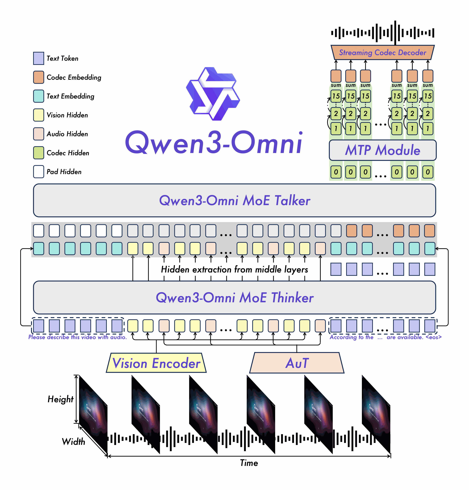

# Qwen3-Omni

[Qwen3-Omni](https://huggingface.co/Qwen/Qwen3-Omni-30B-A3B-Instruct) accepts text, images, audio, and video, and can return text alone or with audio. Use the generator for a hardware-specific launch command, then check the tables for supported configurations.

For shared request examples, response formats, SSE clients, and error handling, see [Omni Model Usage](../basic_usage/omni.md). This page documents Qwen3-Omni deployment, model-specific parameters, and realtime profiles.



The Thinker processes multimodal inputs and generates text. The Talker uses the Thinker's representations and text to produce speech tokens, and the streaming codec decoder turns them into audio.

Figure credit: Qwen team, [official Qwen3-Omni architecture](https://github.com/QwenLM/Qwen3-Omni#model-architecture). See the [release blog](https://qwen.ai/blog?id=65f766fc2dcba7905c1cb69cc4cab90e94126bf4) for the model overview.

## Prerequisites

Install `sglang-omni` using the [installation guide](../get_started/installation.md).

## Server Configuration

Use the selector below to generate the exact launch command for your configuration.

```{raw} html
<div id="sgl-server-gen-mount"></div>
```

## Compatibility Matrix

Colocated topology requires `--config examples/configs/qwen3_omni_colocated_h20.yaml` (or `qwen3_omni_colocated_h200.yaml` on H200) to set per-stage GPU memory budgets.

All configurations listed below are supported.

| Mode | Topology | Thinker TP | Precision |
|---|---|---|---|
| Thinker-only | — | — | BF16 |
| Thinker-only | — | — | FP8 |
| Thinker-only | — | — | AutoRound INT4 |
| Thinker-Talker | Disaggregated | TP=1 | BF16 |
| Thinker-Talker | Disaggregated | TP=1 | FP8 |
| Thinker-Talker | Disaggregated | TP=1 | AutoRound INT4 thinker + BF16 talker/code2wav |
| Thinker-Talker | Disaggregated | TP=2 | BF16 |
| Thinker-Talker | Disaggregated | TP=2 | FP8 |
| Thinker-Talker | Disaggregated | TP=2 | AutoRound INT4 thinker + BF16 talker/code2wav |
| Thinker-Talker | Colocated | TP=1 | BF16 |
| Thinker-Talker | Colocated | TP=1 | FP8 |
| Thinker-Talker | Colocated | TP=1 | AutoRound INT4 thinker + BF16 talker/code2wav |

## Text-Only Deployment

Text-only mode runs the thinker pipeline on a single GPU. It accepts multi-modal input (text, image, audio) and produces text output only.

### Launch a Text-Only Server

```bash
sgl-omni serve \
  --model-path Qwen/Qwen3-Omni-30B-A3B-Instruct \
  --text-only \
  --port 8008
```

Multimodal preprocessing (tokenization, image/video/audio feature extraction) runs serially by default. Add `--preprocessing.factory.max_concurrency 4` to run it on a thread pool when CPU preprocessing is the bottleneck under concurrent load. Threaded preprocessing changes how requests arrive at the thinker, so greedy outputs of the bf16 MoE can differ from the serial default; keep the default when comparing accuracy across runs.

For video decoder thread allocation and overrides, see [Video Decoding](../basic_usage/omni.md#video-decoding).

For MMSU-style audio-input / text-output benchmarks with short requests, use the fused text-path config so the full text path stays inside one worker process:

```bash
sgl-omni serve \
  --model-path Qwen/Qwen3-Omni-30B-A3B-Instruct \
  --config examples/configs/qwen3_omni_mmsu.yaml \
  --text-only \
  --port 8008
```

## Speech Deployment and Tuning

Speech mode runs the full eight-stage pipeline on one or more GPUs. It produces both text (from the thinker) and audio (from the talker) output.

### Launch a Speech Server

Speech mode can run as a colocated one-GPU worker using the colocated config:

```bash
sgl-omni serve \
  --model-path Qwen/Qwen3-Omni-30B-A3B-Instruct \
  --config examples/configs/qwen3_omni_colocated_h20.yaml \
  --colocate \
  --port 8008
```

Use `examples/configs/qwen3_omni_colocated_h200.yaml` on single-H200 workers.

For manual multi-GPU placement, use the example script:

```bash
python examples/run_omni.py qwen3-speech-server \
  --model-path Qwen/Qwen3-Omni-30B-A3B-Instruct \
  --gpu-thinker 0 \
  --gpu-talker 1 \
  --gpu-code-predictor 1 \
  --gpu-code2wav 0 \
  --port 8008
```

Or use the CLI without `--text-only` for the standard speech pipeline:

```bash
sgl-omni serve \
  --model-path Qwen/Qwen3-Omni-30B-A3B-Instruct \
  --port 8008
```

### Memory and Concurrency

For automatic memory sizing, global memory budgets, and per-stage overrides, see [Memory and Concurrency](../basic_usage/omni.md#memory-and-concurrency).

The speech server launcher exposes the same per-stage controls:

```bash
python examples/run_omni.py qwen3-speech-server \
  --model-path Qwen/Qwen3-Omni-30B-A3B-Instruct \
  --gpu-thinker 0 \
  --gpu-talker 1 \
  --gpu-code-predictor 1 \
  --gpu-code2wav 0 \
  --port 8008 \
  --thinker-mem-fraction-static 0.88 \
  --talker-mem-fraction-static 0.88
```

The thinker admits up to 64 running requests by default. Use the thinker-specific flag to lower or raise that limit in either text-only or speech mode:

```bash
sgl-omni serve \
  --model-path Qwen/Qwen3-Omni-30B-A3B-Instruct \
  --thinker.engine.max_running_requests 16
```

For the equivalent YAML layout, see [Memory and Concurrency](../basic_usage/omni.md#memory-and-concurrency).

<span id="codec-coalescing-and-first-audio-latency"></span>

### Speech Chunking and First-Audio Latency

Start with the default speech chunking settings and measure time to first playable audio before tuning. Smaller chunks alone do not guarantee earlier playback. See [speech chunking and first-audio latency](qwen3_omni/tuning.md#speech-chunking-and-first-audio-latency) for frame counts and decoder timing.

### Code2Wav Execution

Code2Wav turns encoded speech into playable audio. Its GPU optimizations are enabled by default, so keep the launch defaults unless you are troubleshooting. See [Code2Wav execution](qwen3_omni/tuning.md#code2wav-execution) for memory requirements and individual optimization controls.

### Speech Stage Placement

Start with the launch examples: the thinker and talker use separate GPUs, and Code2Wav shares the thinker GPU. If you move the thinker, move Code2Wav explicitly when needed and leave memory for both stages. See [speech stage placement](qwen3_omni/tuning.md#speech-stage-placement) for workload trade-offs and measurements.

## Single-GPU FP8 on H100/H20

SGLang-Omni can also serve native FP8 Qwen3-Omni checkpoints. Native FP8 uses the checkpoint quantization config when loading the thinker and talker AR stages, while keeping the same Qwen3-Omni request format shown below.

For one-GPU H100/H20 colocated launch, use the FP8 colocated config:

```bash
sgl-omni serve \
  --config examples/configs/qwen3_omni_fp8_colocated.yaml \
  --colocate \
  --model-name qwen3-omni \
  --port 8008
```

The config file contains the FP8 checkpoint path: `marksverdhei/Qwen3-Omni-30B-A3B-FP8`. You can still pass `--model-path` to override the config value.

The FP8 path keeps dense FP8 GEMM on SGLang `auto` and defaults native FP8 MoE to CUTLASS when supported. For Qwen3-Omni pipeline launches, `SGLANG_JIT_DEEPGEMM_PRECOMPILE=0` is set as a default unless the operator has already set that environment variable. This disables SGLang's all-M DeepGEMM precompile session while keeping DeepGEMM available for dense FP8 GEMMs.

To opt back into SGLang's all-M DeepGEMM precompile behavior:

```bash
SGLANG_JIT_DEEPGEMM_PRECOMPILE=1 sgl-omni serve \
  --config examples/configs/qwen3_omni_fp8_colocated.yaml \
  --colocate \
  --model-name qwen3-omni \
  --port 8008
```

## Single-GPU AutoRound INT4 Thinker on H100/H20

SGLang-Omni also supports AutoRound INT4 quantized Qwen3-Omni checkpoints. AutoRound uses a 4-bit quantization scheme with group size 128, significantly reducing memory footprint compared to BF16 or FP8.

The public AutoRound checkpoint quantizes the thinker transformer layers. In speech mode, the talker and code2wav stages load as BF16 from the same checkpoint. For one-GPU H100/H20 colocated launch, use the colocated config with the AutoRound checkpoint:

```bash
sgl-omni serve \
  --config examples/configs/qwen3_omni_colocated_h20.yaml \
  --colocate \
  --model-name qwen3-omni \
  --model-path Intel/Qwen3-Omni-30B-A3B-Instruct-int4-AutoRound \
  --port 8008
```

AutoRound quantization provides:

- **~50% memory reduction** compared to BF16 (from ~60GB to ~30GB)
- **~25% memory reduction** compared to FP8 (from ~40GB to ~30GB)
- **Accuracy at ultra-low bit widths**: maintains high accuracy even at 2–4 bits, requiring minimal tuning effort thanks to its sign-gradient descent optimization.

## Server Readiness

Qwen3-Omni warms up with a chat request containing a small image, one second of audio, and a short instruction. Speech mode requests text and audio output; text-only mode requests text. Each stage that generates tokens is limited to 8 new tokens. See [Server Readiness](../basic_usage/omni.md#server-readiness) for health status, replica coverage, timeout, and the skip option.

## Input / Output Modalities

Qwen3-Omni accepts text, image, audio, and video input in both text-only and speech deployments. The [shared request examples](../basic_usage/omni.md#general-usage) cover image questions, spoken questions with images or video, and text-and-speech replies. For speech output requirements and text-only server behavior, see [Speech Output](../basic_usage/omni.md#speech-output). Realtime audio negotiation has a separate contract described below.

### Sampling Parameters

The [shared request parameters](../basic_usage/omni.md#request-parameters) document standard sampling fields, output formats, per-stage overrides, and video controls. The table below lists Qwen3-Omni sampling defaults and its talker-specific fields. Standard sampling parameters apply to the thinker; talker parameters apply when `modalities` includes `"audio"`.

| Parameter | Type | Default | Applies to |
|---|---|---|---|
| `temperature` | float | `0.0` (greedy) | Thinker |
| `top_p` | float | `1.0` | Thinker |
| `top_k` | int | `-1` | Thinker |
| `min_p` | float | `0.0` | Thinker |
| `repetition_penalty` | float | `1.0` | Thinker |
| `max_tokens` | int | `2048` | Thinker |
| `talker_temperature` | float | `0.9` | Talker (audio output only) |
| `talker_top_p` | float | `1.0` | Talker (audio output only) |
| `talker_top_k` | int | `50` | Talker (audio output only) |
| `talker_repetition_penalty` | float | `1.05` | Talker (audio output only) |
| `talker_max_new_tokens` | int | `4096` | Talker (audio output only) |

With `use_audio_in_video: true`, requests where all videos lack audio use video-only processing; mixing videos with and without audio is rejected. Audio decoding errors are reported.

For HTTP and SSE errors, see [Known Limitations](../basic_usage/omni.md#known-limitations).

## Realtime Speech with Server-Side Turn Detection

The speech pipeline also streams spoken responses over `/v1/realtime` with `--enable-realtime`, with server-side turn detection and barge-in. Its protocol is in {ref}`Realtime on the speech pipeline <realtime-on-the-speech-pipeline>`; the Session graph that most realtime clients use is in [Turn-Based: Qwen3-Omni](../developer_reference/full_duplex_guide.md#turn-based-qwen3-omni).

## Qwen3-Omni persistent session stages

The session profile serves Qwen3-Omni as a turn-based realtime voice assistant on `/v1/realtime`: a VAD node ends each user turn and the model answers it with the conversation so far. Launching on H100 or H200, settings, the protocol and benchmarking are in [Full-Duplex Guide](../developer_reference/full_duplex_guide.md#turn-based-qwen3-omni).

## Speculative Decoding

The thinker can verify tokens proposed by SpeechSpec's DFlash draft [`yuekai/qwen3_omni_30b_a3b_instruct_dflash_block8`](https://huggingface.co/yuekai/qwen3_omni_30b_a3b_instruct_dflash_block8) or EAGLE3 draft [`yuekai/qwen3_omni_30b_a3b_instruct_eagle3_audio`](https://huggingface.co/yuekai/qwen3_omni_30b_a3b_instruct_eagle3_audio) on a text-only server or in the session profile.

```bash
# DFlash: one 8-token block per step
sgl-omni serve \
  --model-path Qwen/Qwen3-Omni-30B-A3B-Instruct \
  --text-only \
  --thinker.engine.speculative_algorithm DFLASH \
  --thinker.engine.speculative_draft_model_path yuekai/qwen3_omni_30b_a3b_instruct_dflash_block8 \
  --thinker.engine.speculative_num_draft_tokens 8 \
  --port 8000

# EAGLE3: a 3-step chain
sgl-omni serve \
  --model-path Qwen/Qwen3-Omni-30B-A3B-Instruct \
  --text-only \
  --thinker.engine.speculative_algorithm EAGLE3 \
  --thinker.engine.speculative_draft_model_path yuekai/qwen3_omni_30b_a3b_instruct_eagle3_audio \
  --thinker.engine.speculative_num_steps 3 \
  --thinker.engine.speculative_eagle_topk 1 \
  --thinker.engine.speculative_num_draft_tokens 4 \
  --port 8000
```

- **Acceptance statistics.** Set `return_spec_tokens_details: true` to include thinker draft statistics in `sglext.spec_tokens_details`.
- **Context.** These drafts have an 8,192-token context; the prompt, output budget, and speculative reservations must fit. Set `--preprocessing.factory.max_seq_len 8192` to reject oversized prompts early.
- **Sampling.** Use `repetition_penalty=1`, `frequency_penalty=0`, `presence_penalty=0`, and `min_p=0`; disable logprobs and `return_hidden_states`. For `/generate`, set `return_logprob: false`.
- **Scheduling.** Speculative decoding is synchronous by default. Add `--thinker.factory.enable_async_decode true` to overlap work. With `--thinker.factory.async_decode_min_batch_size` set above 1, a decode batch smaller than it, or a prefill after which fewer requests than it are decoding, has its result processed before the next batch is chosen; other batches overlap. Mixed prefill/decode batches (`enable_mixed_chunk=true`) and weight updates are unsupported with a draft.
- **Overlap trade-offs.** Overlap can improve decode throughput, but prefill-heavy workloads or short outputs may have higher TTFT and lower throughput.
- **Prefill boundary.** Set `SGLANG_DISABLE_CONSECUTIVE_PREFILL_OVERLAP=1` before launch to process the previous prefill batch's result before launching the next consecutive prefill batch. This can lower TTFT at a throughput cost; decode rounds still follow `async_decode_min_batch_size`.
- **Execution failure.** A failure during speculative overlap stops the pipeline and fails pending requests.
- **Speech output.** A request server needs `--text-only` with a draft. The session profile keeps speech output with either draft.
- **Sessions.** The session profile takes either draft with synchronous decoding. The draft's 8,192-token context bounds the whole conversation, so add `--thinker.factory.max_seq_len 8192 --preprocessing.factory.max_seq_len 8192` to the session command along with the draft flags above.

## Known Limitations

- **Use the same frame sampling rate for videos in one request.** This is how many frames the model reads per second, not the original video frame rate. Different sampling rates in the same request cause an error.
- **Check the deployment layout when using multiple GPUs.** The colocated layout does not support splitting the text-generation model across two GPUs. If you need that setup, choose the disaggregated layout in [Server Configuration](#server-configuration).
- **Long inputs leave less room for the answer.** The model has a limit on how much input and output it can handle together. If a request is too long, shorten the input or ask for a shorter answer. A long spoken question can also cause the audio reply to stop before the text reply finishes.

## Advanced Guides

- [Speech tuning](qwen3_omni/tuning.md): speech chunking, Code2Wav GPU optimizations, and stage placement measurements.

```{toctree}
:hidden:

qwen3_omni/tuning
```
