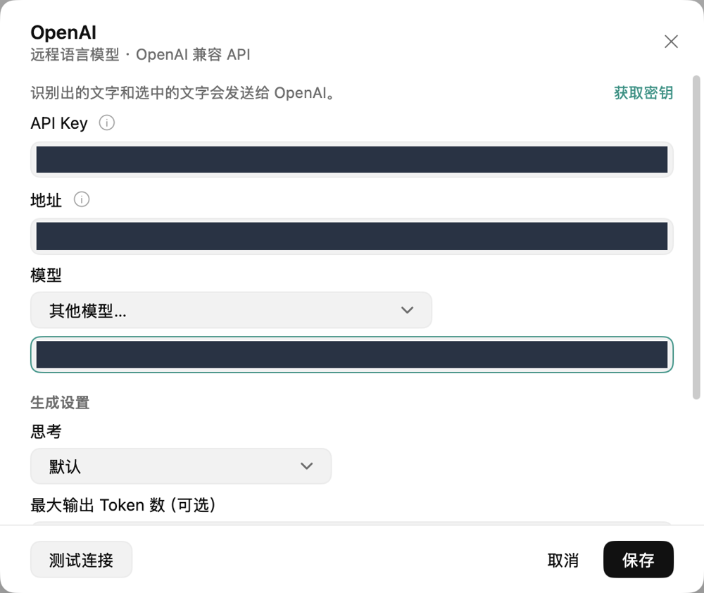

# 用自己的 API Key 配置 Voxt（BYOK）

<video controls playsinline preload="none" width="100%" src="../../_static/voxt-tutorials/byok.mp4"></video>

[打开 MP4 视频](../../_static/voxt-tutorials/byok.mp4)

在 Voxt 里保存并测试一个语言模型服务，就能在翻译、改写以及需要润色的转录中使用它。本地 ASR 负责把声音变成文字。语言模型按所选功能处理文字。

## 先准备服务商给你的值

打开你有权限使用的服务商控制台，进入 **API Keys**，创建或复制给 Voxt 使用的 Key。由团队提供服务时，从团队指定的安全渠道领取。使用兼容 OpenAI 的自定义服务时，再从同一个服务商取得**模型 ID**和**完整请求端点**。这三项应属于同一套服务配置。

## 把 Key 填进 Voxt

1. 在首次设置的**模型**一步点**设置语言模型**，或直接打开 Voxt 侧栏的**语言模型**。
2. 选择你的服务商。使用兼容 OpenAI Chat Completions 的服务时，打开 **OpenAI** 卡片，在**模型**下拉框选**其他模型…**（有的版本叫**自定义…**）。服务商自带的预设可直接从下拉框选择。
3. 在**模型 ID**粘贴服务商给出的准确 ID。如果输入框叫**地址**，填服务商提供的 API 根地址，通常以 `/v1` 结尾。如果你的版本显示**端点**并要求完整请求地址，就填服务商给出的完整 Chat Completions 端点。使用内置预设和官方服务时可以保留默认地址。
4. 在**API Key** 输入框按 `⌘V` 粘贴 Key。本页所说的上传 Key 就是把它填入 Voxt 的这个密码字段。输入后界面用圆点显示，保存时 Key 写入这台 Mac 的钥匙串。首次设置可以保留默认生成设置。
5. 点**测试连接**（有的版本叫**测试**），看到**连接正常**后点**保存**。测试会访问你配置的服务。自定义服务若提供不同协议，在**高级**中核对 API 格式与服务商要求一致。

## 让功能使用这套配置

打开侧栏的**翻译**或**改写**，在该功能的**语言模型**下拉框选择刚保存的配置。在**转录**中，只有需要清理口头语或润色时才选择语言模型。用一句公开样例试一次即可确认，例如「请在周五前确认时间」。

如果测试失败，先核对 Key 是否属于该端点、模型 ID 是否逐字一致，以及该 Key 是否能访问该模型。遇到服务拒绝或限流，到服务商控制台核对权限和额度，修正后重新点**测试**。

## 交给 Agent

> 按本页打开 Voxt 的语言模型设置，根据我提供的服务商与 API 格式选择预设或自定义。填完非敏感设置后停在 API Key 字段，让我从安全渠道取出并直接粘贴。请勿读取、回显或截图这个字段。等我完成后，用 Voxt 的测试按钮检查连接，保存，再为我指定的功能选用这个配置。用非敏感示例确认成功，仅报告状态。
