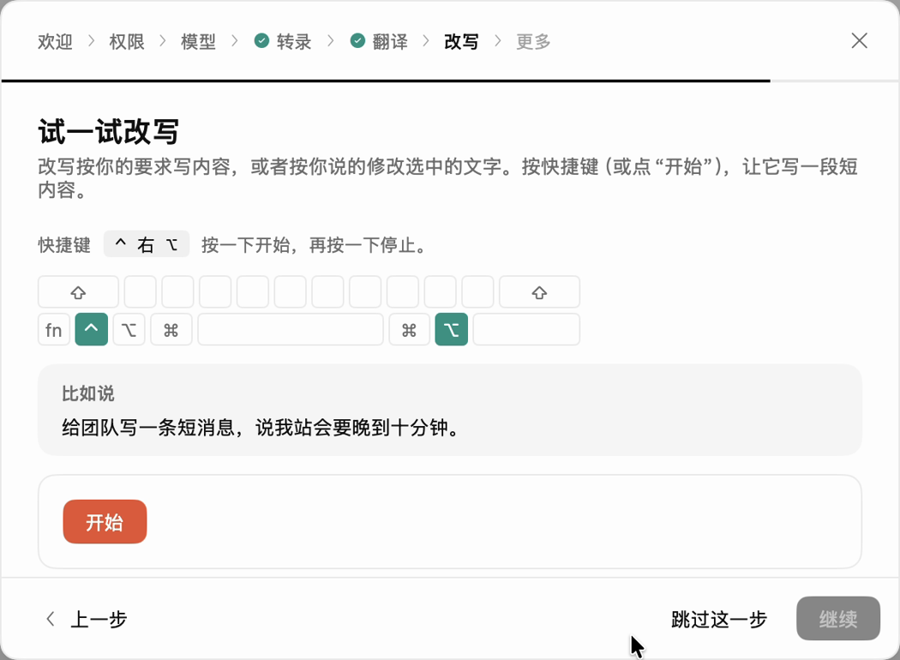

# 用 Voxt 改写文字（转写）

<video controls playsinline preload="none" width="100%" src="../../_static/voxt-tutorials/rewrite.mp4"></video>

[打开 MP4 视频](../../_static/voxt-tutorials/rewrite.mp4)

在 2.0.3 中文界面里，Rewrite 叫**改写**。你可以选中文字，再用语音告诉 Voxt 怎么改。先[配置语言模型](byok.md)，并[准备本地语音识别模型](start.md#安装并下载-asr)。

1. 在 Voxt 的**改写**页确认已选好语音识别模型和语言模型。打开一个空白文档，输入并选中「我明天有事，咱们换个时间吧」。
2. 轻按 `⌃ Control` + 右 `⌥ Option`，说「改成礼貌简洁的改期消息」，再按同样的快捷键结束。
3. 查看答案卡片。满意后点**插入**替换选区，或点**复制**自行粘贴。还想改时点**继续**，再说「加一句谢谢」。

也可以把光标放在空白处直接说写作要求。当前快捷键以**改写**页为准。

## 交给 Agent

> 按本页确认 Voxt 改写已选用可用的语音识别模型和语言模型。在一个新文档里放入公开的示例句并选中它，等我用语音说明怎么改。保留答案卡片给我审阅，由我决定是否插入。
