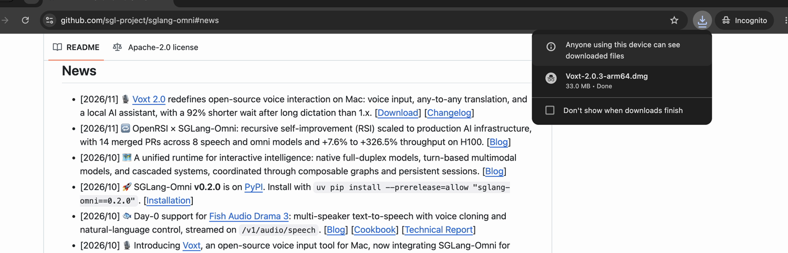
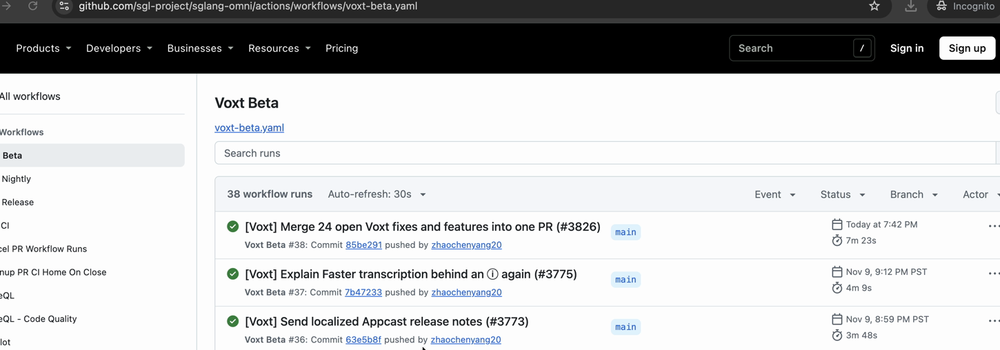
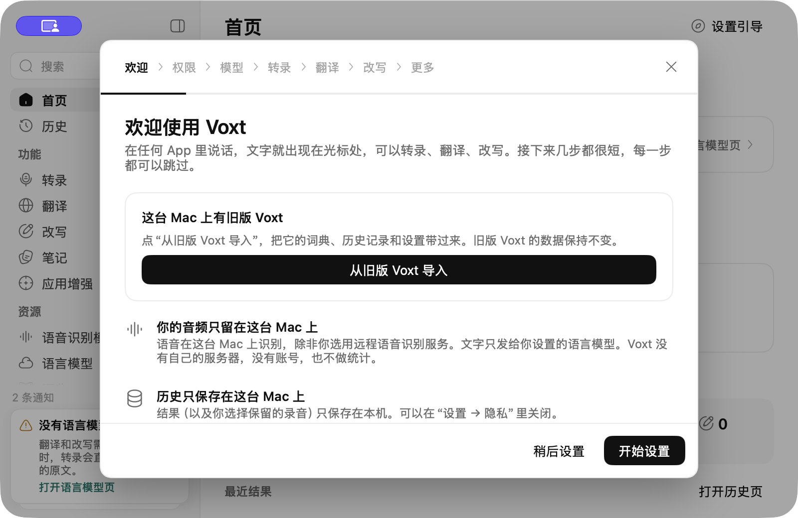
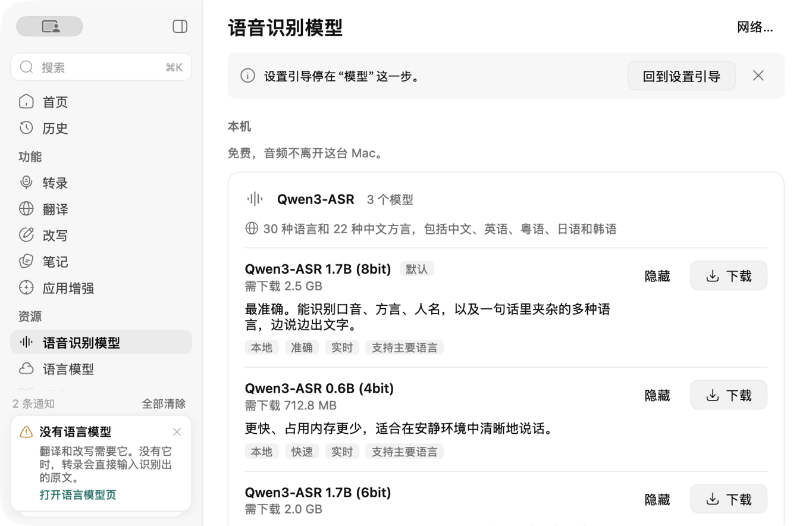

# 安装 Voxt 和下载语音识别模型

<video controls playsinline preload="none" width="100%" src="../../_static/voxt-tutorials/start.mp4"></video>

[打开 MP4 视频](../../_static/voxt-tutorials/start.mp4)

使用 Apple 芯片的 Mac 需要 macOS 15 或更新版本。第一次安装，选 **Voxt 2.0.3 正式版**。需要验证最新改动时，选下方的 Beta 路线。

## 下载 2.0.3 正式版

[一键下载 Voxt 2.0.3（Apple 芯片）](https://github.com/sgl-project/sglang-omni/releases/download/voxt-v2.0.3/Voxt-2.0.3-arm64.dmg)

也可以从以下入口找到同一个版本号的安装包。

- 仓库首页往下到 **News**，找到 **Voxt 2.0**，点 **Download**。 [SGLang Omni News](https://github.com/sgl-project/sglang-omni#news)
- 在 **Voxt v2.0.3** 发布页展开 **Assets**，点 `Voxt-2.0.3-arm64.dmg`。 [GitHub Releases](https://github.com/sgl-project/sglang-omni/releases/tag/voxt-v2.0.3)
- 在 **Get Started** 打开 **Install Voxt (Mac app)**，从该页进入下载。 [SGLang Omni 安装文档](https://sgl-project.github.io/sglang-omni/get_started/voxt.html)
- 在 **v2.0.3** 条目点 **Download**。Changelog 可能给这条加上 **Beta** 标签，选择文件名为 `Voxt-2.0.3-arm64.dmg` 的包。 [Voxt Changelog](https://voxt.actnow.dev/changelog)

## 下载按次构建的 Beta

打开安装文档后，可点 **Download Voxt Beta** 一键下载列出的构建。以下步骤适用于查找更新的 Beta。 [SGLang Omni 安装文档](https://sgl-project.github.io/sglang-omni/get_started/voxt.html)

1. 打开 **Voxt Beta**，找最近一个 `main` 分支且标记为 **Success** 的构建。 [SGLang Omni Voxt Beta](https://github.com/sgl-project/sglang-omni/actions/workflows/voxt-beta.yaml)
2. 进入该次构建，滚到 **Artifacts**，点击 `Voxt-…-beta.…-arm64`。GitHub 要求登录才能下载构建产物。如果已过期，回列表选择更新的成功构建。
3. 解压下载的 ZIP，再打开里面的 `.dmg`。文件名里带 `-beta.`，可以用它区分每次构建和正式版。

## 安装并下载 ASR

1. 打开 `.dmg`，把 **Voxt** 拖到 **Applications（应用程序）**。从应用程序打开 Voxt。有旧版时先退出旧版，按需决定是否替换或导入。
2. 在**设置引导**点**开始设置**。在**权限**一步允许**麦克风**和**辅助功能**，再点**继续**。如系统要求重启 Voxt，关闭后从应用程序重新打开。

   

3. 到**模型**一步，点**下载并继续**。推荐的本地 ASR 是 **Qwen3-ASR 1.7B (8bit)**，约 2.5 GB。可以先继续引导。等它显示可用后再试转录。
4. 如果已跳过引导，回侧栏**语音识别模型**，在本机模型区找到同一个型号并点**下载**。如果模型已可用，可直接选择。需要重新打开引导时，去**设置 → 通用 → 打开设置引导**。

   
5. 打开一个空白文本框，轻按右 `⌥ Option`，说「明天下午三点开会」，再轻按右 `⌥ Option`。看到文本出现在光标处，就完成了本地转录的基本设置。

接下来可以[配置自己的 API Key](byok.md)，用于翻译、改写和可选的转录润色。

## 交给 Agent

> 按本页在 Apple 芯片 Mac 上安装 Voxt 2.0.3 正式版。只有我明确要求 Beta 时才下载 Actions 的 Beta 包。遇到替换旧版、导入历史或 macOS 权限授权时让我确认。下载推荐的本地语音识别模型，等到显示可用。用空白文本框和一句测试内容确认转录能输出，告诉我安装的版本和结果。
