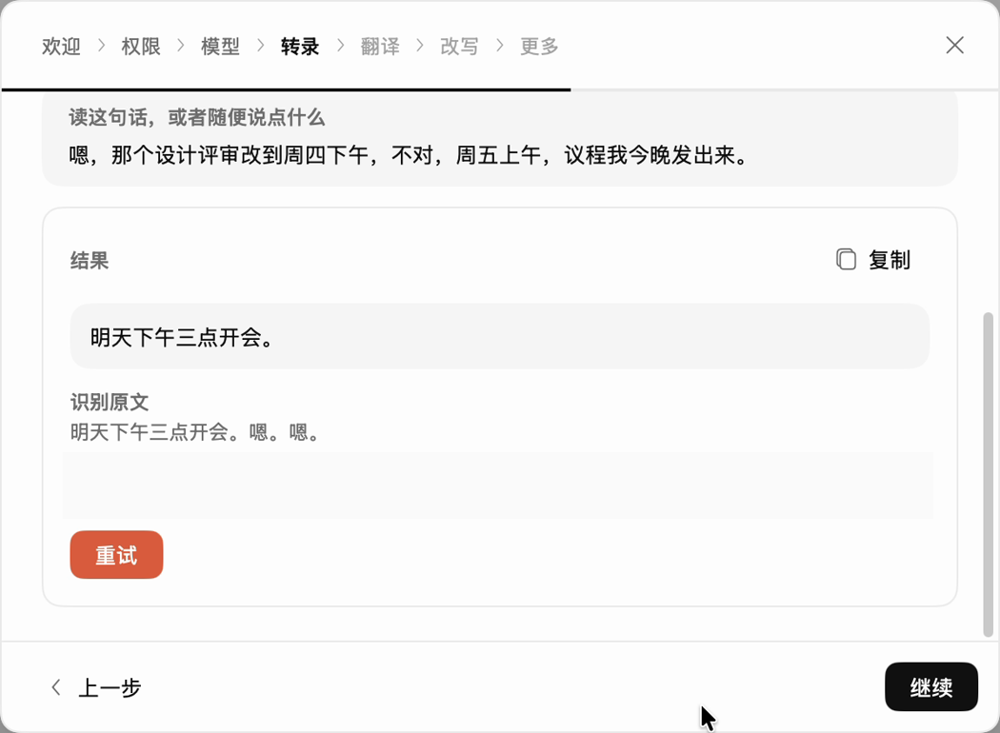

# 用 Voxt 把说的话转录成文字

<video controls playsinline preload="none" width="100%" src="../../_static/voxt-tutorials/transcribe.mp4"></video>

[打开 MP4 视频](../../_static/voxt-tutorials/transcribe.mp4)

转录把讲话输入到当前 App 的光标处。先在 Voxt [下载本地语音识别模型](start.md#安装并下载-asr)，并允许麦克风和辅助功能。

1. 在 Voxt 侧栏打开**转录**，确认**语音识别模型**选的是已下载、可用的本地模型。先用默认快捷键右 `⌥ Option`。
2. 打开一个空白文本框，点一下放好光标。轻按右 `⌥ Option` 开始，说「明天下午三点开会」，再轻按右 `⌥ Option` 结束。
3. 等文字出现在光标处。若已开启答案卡片，点**插入**或**复制**。

想去掉口头语或整理表达时，在**转录**页选用[已配置的语言模型](byok.md)。如果有识别结果但没出现在文本框，检查光标位置、答案卡片和 macOS 辅助功能权限。当前快捷键以**转录**页为准。

## 交给 Agent

> 按本页检查 Voxt 的本地语音识别模型和转录快捷键，打开空白文本框，等我用一句无敏感内容的话试录。结束后核对结果是否插到光标处。若系统需要授权，请让我操作。
