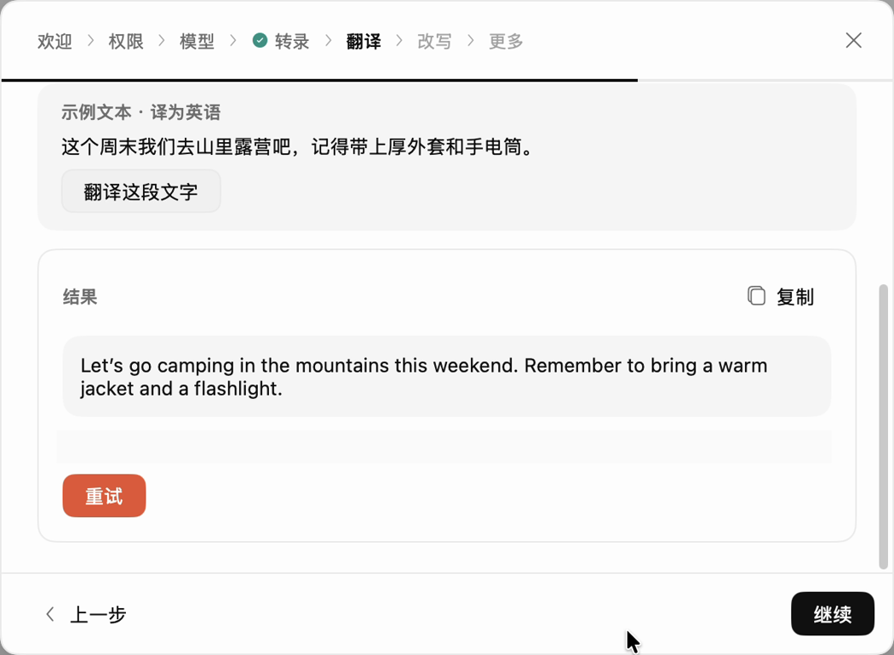

# 用 Voxt 翻译

<video controls playsinline preload="none" width="100%" src="../../_static/voxt-tutorials/translate.mp4"></video>

[打开 MP4 视频](../../_static/voxt-tutorials/translate.mp4)

可以翻译一段选中的文字，也可以直接说一句话，让 Voxt 输出目标语言。先[配置语言模型](byok.md)。语音翻译还需要[下载并选好语音识别模型](start.md#安装并下载-asr)。

1. 在 Voxt 侧栏打开**翻译**，选择**目标语言**和**语言模型**。第一次可以把目标语言设为英语。
2. **翻译说的话**。在空白文本框把光标放好，轻按 `⇧ Shift` + 右 `⌥ Option`，说「请在周五前确认时间」，再按一次同样的快捷键。
3. **翻译选中的文字**。先选中「请在周五前确认时间」，按 `⇧ Shift` + 右 `⌥ Option`，等待译文即可。
4. 如果启用了答案卡片，检查译文后点**插入**或**复制**。直接输出时，译文会出现在光标处或替换选区。

可以在**翻译**页查看当前快捷键。如果第 2 步直接开始翻译已有文字，先取消文本选区再试。

## 交给 Agent

> 按本页把 Voxt 翻译的目标语言设为英语，选择已配置的语言模型。用一个新的空白文档和「请在周五前确认时间」测试选区翻译，保留原文供我对照。语音翻译需要我说话时请停在准备开始的位置。
